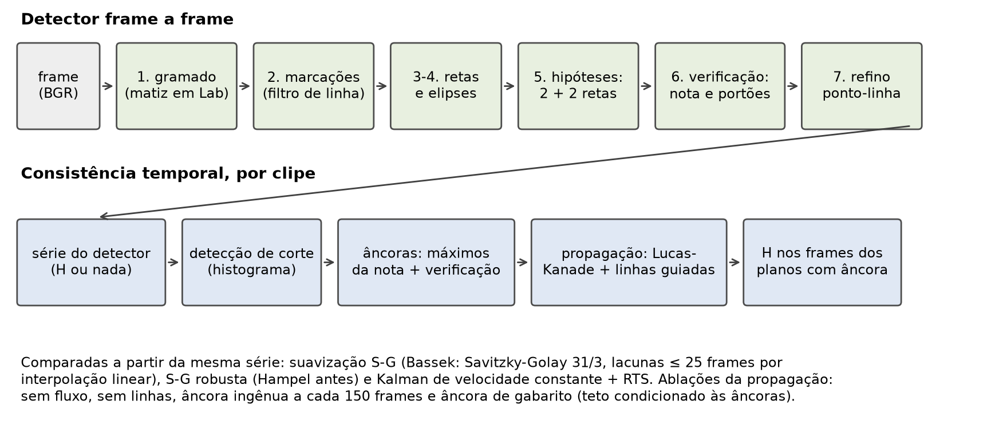
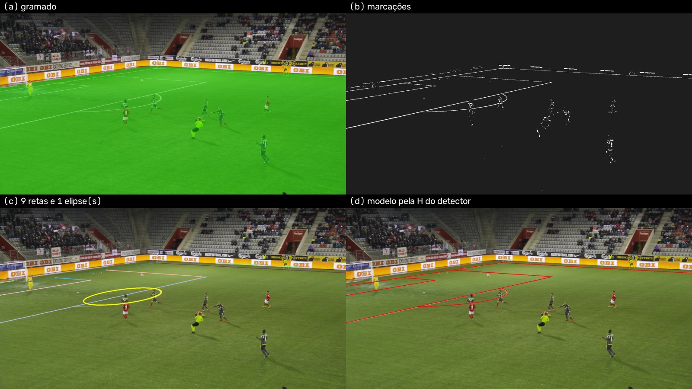
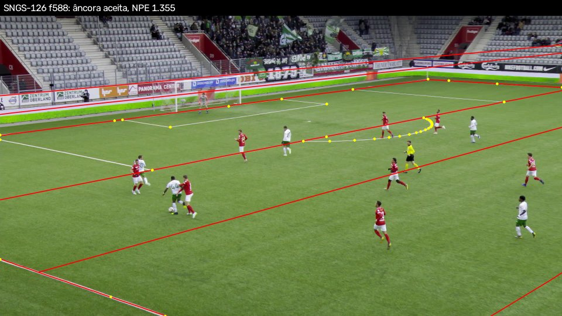
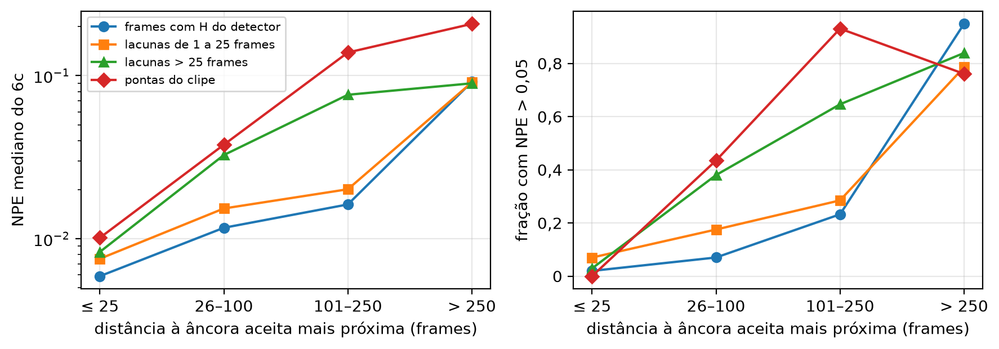
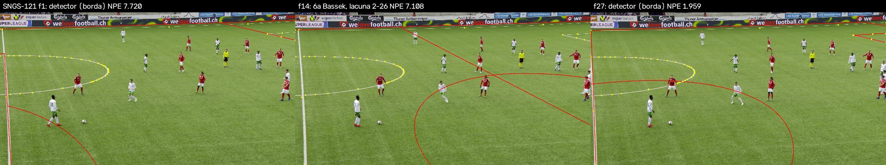

# Resumo

Este trabalho estima a homografia entre o gramado e o frame de uma transmissão de futebol usando apenas processamento digital de imagens clássico, sem redes neurais, e mede quanto a propagação temporal por fluxo óptico recupera das falhas desse detector. O detector segmenta o gramado por matiz, realça as marcações com um filtro de linha, detecta retas por Hough e elipses, gera hipóteses a partir de duas retas de cada uma de duas famílias de paralelas, verifica-as contra a imagem e refina a melhor por um ajuste ponto-linha. A propagação (6c) parte de âncoras verificadas e leva a homografia pelos frames vizinhos com Lucas–Kanade, reestimando-a com pontos rastreados e com os pixels das linhas. A avaliação foi feita numa rodada única, com o método congelado, no test do SoccerNet-GSR (49 clipes de 3 jogos) e do WC14 (186 imagens). No GSR, o detector produz homografia em 0,505 dos frames e tem LocSim@5 penalizado de 0,419. Com a propagação, a cobertura sobe para 0,897 e o LocSim@5 penalizado para 0,749, o que fecha 0,959 da distância até o teto da mesma propagação partindo de âncoras de gabarito. Na medida da tabela 7 do AuxFlow, o pipeline completo fica abaixo do NBJW (0,885) e do AuxFlow (0,929). O ganho da propagação (+0,330) é muito maior que o do AuxFlow sobre o NBJW (+0,044), mas parte de uma base mais baixa e vem quase todo da cobertura. Entre as estratégias de consistência temporal, o filtro de Kalman dá a série mais lisa, e a propagação é a que melhor acompanha o movimento real da câmera e a que menos inverte a visibilidade dos jogadores. As limitações principais são a dependência do detector de duas famílias de retas, que deixa sem âncora as vistas do meio-campo, e a deriva da propagação longe das âncoras.

# 1. Introdução

Para levar um pixel de uma transmissão de futebol a uma coordenada em metros no campo, é preciso estimar a transformação entre a imagem e o gramado. Como o gramado é aproximadamente plano, essa transformação é uma homografia: uma matriz 3 × 3 com oito graus de liberdade, determinada por no mínimo quatro correspondências. As marcações do campo são padronizadas, mas três dificuldades tornam o problema difícil na prática:

- as marcações são esparsas, concentradas nas grandes áreas e no círculo central, e há regiões extensas do gramado sem nada a detectar;
- as câmeras de transmissão usam zoom, e um plano fechado pode não mostrar marcação nenhuma;
- a estimativa feita frame a frame é instável, e o tremor entre frames inviabiliza usos como inserir grafismo ou derivar a velocidade de um jogador a partir da posição.

A área migrou para detectores de pontos-chave treinados. Este trabalho faz a pergunta oposta (`00-problema`):

> Até onde chega um pipeline de registro de campo puramente clássico — cor, morfologia, Hough, ajuste de cônica, RANSAC — e quanto da diferença para o estado da arte a propagação temporal por fluxo óptico consegue fechar?

A hipótese é que a propagação tenha ganho marginal maior sobre um detector fraco do que sobre um forte: se o detector acerta metade dos frames, os frames bons podem sustentar os ruins. O resultado das âncoras ingênuas do AuxFlow indica a condição: isso só vale se as âncoras forem bem escolhidas. Se a hipótese se confirmar, um sistema leve e sem GPU pode ser viável para aplicações offline.

A segunda pergunta vem de Bassek et al. (2025):

> Qual das três estratégias de consistência temporal — suavização da série de homografias, filtragem por Kalman, propagação por fluxo óptico — entrega mais estabilidade, e a que custo?

O trabalho mede também a consequência prática do erro de registro, seguindo Bassek et al. (2025): com que frequência o registro troca o rótulo de visibilidade de um jogador, colocando fora do quadro quem está dentro.

As contribuições são: (1) um detector frame a frame sem aprendizado profundo, avaliado no WC14 e no SoccerNet-GSR; (2) a medição do ganho da propagação de Lucas–Kanade sobre esse detector fraco, com ablações (sem fluxo, sem linhas, âncora ingênua, âncora de gabarito) e uma comparação direta com o AuxFlow no subconjunto difícil HSB; (3) a comparação das três estratégias de consistência temporal em estabilidade e em inversão de visibilidade; (4) um protocolo com calibração só no treino, congelamento do código e uma rodada única no test, com determinismo conferido bit a bit.

O texto segue a ordem: trabalhos relacionados (Seção 2), método (Seção 3), dados (Seção 4), protocolo (Seção 5), resultados (Seção 6), análise de falhas (Seção 7), limitações e trabalho futuro (Seção 8) e conclusão (Seção 9). As tabelas completas da rodada estão no Apêndice A, e o detalhe do protocolo, no Apêndice B.

# 2. Trabalhos relacionados

**Detectores treinados.** O PnLCalib (Gutiérrez-Pérez & Agudo, 2026) usa uma rede HRNetv2 que produz mapas de calor sobre uma grade hierárquica de pontos derivada geometricamente do campo. As correspondências incluem interseções diretas de linhas, interseções de linhas prolongadas, interseções de linha com elipse, pontos de tangência e pontos auxiliares no eixo central; na ablação dos autores, cada conjunto aumenta a cobertura. O módulo de refinamento otimiza pontos e linhas em conjunto, e o ganho do refino vem das linhas: refinar só com pontos quase não muda o resultado. O BroadTrack (Magera et al., 2025) modela fisicamente a lente e o tripé da câmera de transmissão, encontra na distorção de lente o maior ganho da sua ablação no GSR e reinicia o rastreamento quando a confiança, o IoU entre as marcações detectadas e o modelo projetado, cai abaixo de 0,5. Segundo a avaliação do AuxFlow (tabela 7), no GSR o BroadTrack tem o maior IoU do campo inteiro (0,8397 contra 0,8352 do AuxFlow), mas perde no IoU da parte visível (0,9224 contra 0,9426) e no erro de reprojeção em metros (1,34 contra 0,84 m).

**Propagação temporal.** O AuxFlow (Ziegler et al., 2026) escolhe frames-âncora com uma heurística sobre os pontos-chave e uma métrica substituta de IoU, amostra uma grade regular de 2,5 × 2 m de pontos auxiliares do campo, rastreia-os com Lucas–Kanade com verificação de ida e volta (erro ≤ 1 px) e reestima a homografia com os pontos-chave e os pontos propagados. No subconjunto difícil HSB do GSR, partindo da homografia de gabarito, o AuxFlow tem LocSim médio de 83,67%; sem o fluxo, cai para 23,42%, e sem os pontos-chave do detector, para 78,30%. O Lucas–Kanade venceu o RAFT (83,67 contra 78,71), porque retém mais que o dobro de pontos. A grade regular vence a amostragem geométrica (39,68) e empata com a aleatória (83,39). A escolha das âncoras é decisiva: no GSR completo, âncoras a cada 150 frames (82,48) ficam abaixo do detector sem propagação (83,48), as heurísticas chegam a 90,65 e a âncora de gabarito a 91,88. Com a homografia inicial perturbada, a propagação ainda chega a 54,74 contra 43,15 do detector sozinho. Na tabela 7 do AuxFlow, no GSR test, o LocSim@5 é 0,885 para o NBJW (Gutiérrez-Pérez & Agudo, 2024), o detector treinado em que o AuxFlow se apoia, e 0,929 para o AuxFlow. A propagação sempre foi avaliada acoplada a um detector forte; o ganho dela sobre um detector inteiro fraco não tinha sido medido.

**Filtragem e suavização.** O BHITK (Claasen & de Villiers, 2024) relaciona a homografia de um frame à do seguinte por uma transformação afim, com um filtro de Kalman em dois estágios e a incerteza dos pontos-chave modelada. Segundo o texto do AuxFlow (seção 5.6), ele melhorou levemente no TSWC; a tabela 7 do AuxFlow, que só traz o GSR, mostra-o praticamente igual ao NBJW (0,8852 contra 0,8851). Bassek et al. (2025) usaram o TVCalib (Theiner & Ewerth, 2023) para estimar a região visível do campo em transmissões reais e suavizaram a série das homografias com um filtro de Savitzky–Golay de janela 31 e grau 3, preenchendo antes lacunas de até 25 frames por interpolação linear. Os autores registram que o efeito desse pós-processamento sobre a consistência temporal e sobre frames difíceis, como os de zoom grande, não tinha sido testado; a validação foi qualitativa. Eles contaram em média 981 cortes por partida (10,9 por minuto), e, no feed de scouting, falhas de registro deixaram só um jogador visível em 1% do material e nenhum em 3%.

**Métodos clássicos e avaliação.** O levantamento de Manafifard et al. (2017) sobre rastreamento de jogadores trata a detecção do gramado como a primeira etapa canônica, por histograma de cor ou mistura de gaussianas, com vantagem para a mistura. Maglo et al. (2023) observam que, com pontos em grade uniforme, o RANSAC tende a escolher pontos do lado distante do campo, concentrados na imagem, e propõem uma amostragem que acompanha a perspectiva. Citraro et al. (2020) desaconselham o IoU medido só na parte visível, porque recortar pela região visível remove justamente o que está desalinhado. Os números publicados usam moldes de campo diferentes: o PnLCalib avalia o WC14 em 115 × 74 jardas, e Chu et al. (2022), no KpSFR, e Maglo et al. (2023), em 100 × 60 m. O IoU do campo inteiro e o erro em metros dependem do molde.

# 3. Método

O pipeline tem duas partes (Figura 1): um detector que estima a homografia em cada frame, isoladamente, e uma etapa temporal que usa a série do detector num clipe. A homografia é sempre tomada no sentido campo → imagem, com o campo em metros, a origem no centro e Y positivo em direção à câmera principal. O modelo do campo tem 105 × 68 m, com as marcações das Regras do Jogo. Todas as constantes estão no `config.yaml`, cada uma com a origem: artigo, norma do campo ou calibração na partição de treino.

## 3.1 Detector frame a frame

A Figura 2 mostra as etapas num frame do treino.

1. **Gramado.** Converte-se o frame para Lab e mede-se o ângulo de matiz em (a\*, b\*) em relação ao pico do próprio frame, o que absorve o balanço de branco de cada transmissão. O gramado são os pixels a até 20° do pico, com croma mínimo, seguidos de abertura, fechamento, maior componente conexo e preenchimento de buracos. Cada passo foi mantido por ganho medido de IoU no WC14 de treino, contra as máscaras de gramado anotadas: a configuração final tem IoU médio de 0,9861.
2. **Marcações.** Um filtro de linha marca o pixel significativamente mais claro, em L\*, que os vizinhos a uma distância proporcional à largura esperada da linha naquela altura da imagem, dos dois lados. O filtro só atua dentro do gramado dilatado. O limiar de contraste foi calibrado em cada base no próprio treino: 15 no WC14 e 30 no GSR.
3. **Retas.** Transformada de Hough probabilística, um filtro de forma que retira os componentes compactos (jogadores) e a fusão de segmentos colineares, sem a qual uma linha do campo vira dezenas de fragmentos.
4. **Elipses.** Candidatas formadas por trios de cordas curtas vizinhas, reajustadas com `cv2.fitEllipse` e aceitas por apoio, forma e uma âncora geométrica: uma reta que cruza a elipse perto do centro, no círculo central, ou as pontas do arco junto à linha da grande área. O centro da elipse projetada nunca vira correspondência, porque a perspectiva o desloca do centro do círculo.
5. **Hipóteses.** Os segmentos são agrupados em duas famílias pelos pontos de fuga. Duas retas de cada família, entre as mais longas, são atribuídas a linhas do modelo da mesma família, respeitando a ordem, e as quatro interseções dão uma homografia. A simetria de 180° do campo é desfeita pela convenção de que Y cresce em direção à câmera. **Essa geração de hipóteses exige 2 + 2 retas de duas famílias de paralelas** — o ponto que mais limita o detector (Seção 7).
6. **Verificação.** Cada hipótese recebe uma nota com três termos, cada um entre zero e um, com pesos iguais: a fração dos segmentos explicada pelo modelo projetado, a fração do modelo projetado sobre o gramado que cai numa marcação e o IoU entre o campo projetado e o gramado da etapa 1. A melhor hipótese só é aceita se passar por dois portões, fração explicada ≥ 0,45 e IoU ≥ 0,85, calibrados logo abaixo do percentil 5 que a homografia de gabarito atinge no treino.
7. **Refino.** A melhor hipótese é refinada por um ajuste ponto-linha com perda robusta: os pixels da máscara de marcações numa faixa em volta de cada linha do modelo projetado são levados às linhas, e os círculos entram pela distância de Sampson à cônica projetada. Esse ajuste é a mesma função que produz o gabarito do GSR (Seção 4) e aceita só soluções bem determinadas. As elipses são conferidas depois da homografia; uma elipse rejeitada devolve as suas cordas às retas, e o frame é reclassificado uma vez.

Sem quatro retas utilizáveis, ou sem hipótese que passe nos portões, o frame é reportado como falha de cobertura: nenhuma homografia é inventada. A ablação com correspondências de pontos e RANSAC antes do refino foi neutra no treino e não entrou no caminho principal.

## 3.2 Consistência temporal

O detector roda em todos os frames de cada clipe, e a série resultante (homografia ou nada, por frame) alimenta as estratégias abaixo. Todas são comparadas a partir da mesma série.

- **6a — suavização.** A versão de Bassek et al. (2025): lacunas de até 25 frames preenchidas por interpolação linear dos nove elementos da matriz normalizada, seguidas de Savitzky–Golay de janela 31 e grau 3. A versão "robusta" aplica antes um filtro de Hampel na representação por pontos, que descarta homografias discrepantes da vizinhança; a janela e o limiar foram calibrados no treino.
- **Kalman de velocidade constante com suavizador RTS.** É uma versão simplificada, e não o BHITK. Roda sobre as coordenadas no campo de quatro pontos fixos da imagem, com uma porta de Mahalanobis contra homografias erradas; os ruídos de processo e de medição foram calibrados no treino.
- **6b — cortes.** A distância de Bhattacharyya entre histogramas HSV de frames consecutivos detecta os cortes, e nenhuma estratégia atravessa um corte. O limiar foi calibrado no treino com cortes sintéticos.
- **6c — propagação por Lucas–Kanade.** As âncoras candidatas são os máximos locais da nota do detector, em ±12 frames. Cada candidata passa por uma verificação temporal: a homografia dela, levada pelo movimento que o Lucas–Kanade mede, tem que concordar com a do detector em pelo menos 2 vizinhos, com maioria. Cada frame recebe a homografia da âncora mais próxima do mesmo plano (entre cortes), propagada nos dois sentidos do tempo. A cada frame, uma grade de 2,5 × 2 m de pontos do campo, projetada pela homografia corrente, é rastreada por Lucas–Kanade piramidal com verificação de ida e volta (erro ≤ 1 px), sem os pontos sobre jogadores e bola (os componentes compactos de não-gramado). A homografia é reestimada com os pontos rastreados e com os pixels das marcações em volta das linhas do modelo projetado. **A saída do 6c é a homografia propagada e reestimada.** A do detector só entra na escolha e na verificação das âncoras. Um plano sem âncora fica sem homografia.

As ablações do 6c isolam cada componente: **sem fluxo** (a homografia da âncora copiada até o meio do caminho entre âncoras), **sem linhas** (só os pontos rastreados na reestimativa), **âncora ingênua** (a primeira homografia do detector em cada bloco de 150 frames, sem verificação) e **âncora de gabarito** (a homografia de gabarito nos mesmos frames das âncoras verificadas, com a mesma propagação). A âncora de gabarito separa o erro da âncora do erro da propagação e serve de teto.

# 4. Dados

**WC14** (Homayounfar et al., 2017): 209 imagens de treino e 186 de teste, de jogos diferentes da Copa do Mundo de 2014, em 1280 × 720, com homografia anotada à mão e máscara do gramado. As imagens não estão em sequência e servem para avaliar só o detector. A convenção do arquivo (imagem → molde em jardas) foi verificada e convertida para a interna.

**SoccerNet-GSR** (Somers et al., 2024): clipes de 750 frames consecutivos a 25 fps, em 1920 × 1080, da câmera principal, com 57 clipes de treino, 58 de validação e 49 de teste. Cada partição tem 3 jogos; o test tem os jogos 7, 8 e 11, com 16, 19 e 14 clipes. O arquivo não traz parâmetros de câmera. Traz as linhas do campo anotadas na imagem e, para cada pessoa, a caixa na imagem e a posição no campo (`bbox_pitch`), que vem da calibração do próprio dataset.

- **Gabarito.** A homografia de gabarito de cada frame é um ajuste ponto-linha às linhas anotadas, com aceite só quando bem determinado. Esse gabarito é a referência do NPE, do IoU e da classificação das âncoras em certas ou erradas (NPE > 0,05).
- **Correções de rótulo.** Foram corrigidas trocas de classe na anotação das linhas, achadas por uma varredura do gabarito, sem nenhuma saída do método. Sete clipes do test têm correção (SNGS-119, SNGS-121, SNGS-133, SNGS-148, SNGS-149, SNGS-187 e SNGS-199). As correções não afetam o LocSim, que usa as posições anotadas das pessoas, e sim o NPE e o IoU contra o gabarito.
- **Protocolo do AuxFlow.** Para comparar com o AuxFlow, usa-se também a `H_gt_auxflow`: RANSAC (3 px) sobre os pés das pessoas e as posições delas no campo, que reproduz a mediana e a distância da tabela 2 do AuxFlow. É a homografia inicial da medição de "só propagação" no HSB.
- **HSB.** O subconjunto difícil do AuxFlow (tabela 3 deles) tem 10 clipes, todos no test, cada um com um intervalo de frames e o LocSim@5 do NBJW. Os intervalos foram transcritos do artigo para `data_splits/hsb.csv`, com duas suposições registradas: a numeração a partir de 0 e a leitura do intervalo "90–0" do SNGS-128 como 0–90, propagado de trás para frente.

# 5. Protocolo experimental

**Partições.** Todo parâmetro empírico foi calibrado só no treino (WC14 `train_val`, GSR `train`). A validação do GSR serviu só para relatório, com uma exceção registrada: na calibração da segmentação, ela escolheu entre variantes, e nenhuma passou. O número limpo do GSR é o do test. O WC14 test e o GSR test ficaram intocados até a rodada final.

**Métricas.**

- **LocSim@5** (protocolo do GSR): o pé de cada pessoa anotada vai ao campo pela inversa da homografia estimada, e a similaridade é exp(ln(0,05)·d²/τ²), com τ = 5 m e d a distância à posição anotada. Não depende do gabarito. O **penalizado** divide a soma das similaridades pelo total de pessoas de todos os frames: a pessoa de um frame sem homografia vale 0. É o comparável com métodos que respondem em todos os frames. O LocSim **nos cobertos** usa só os frames com homografia; é otimista, porque premia quem só responde nos frames fáceis. O **mAP-LocSim** é a média de τ = 1 a 10 m. O agregado é sobre pessoas-frame.
- **Geometria:** NPE (deslocamento na imagem, dividido pela altura, dos pontos de uma grade de 2,5 × 2 m do campo visíveis pelo gabarito), IoU do campo inteiro (vista de cima) e IoU da parte visível (na imagem). No WC14, também o erro em metros (RE) e o protocolo do KpSFR, com o código deles sem mudança.
- **Cobertura:** a fração de frames (ou imagens) com homografia.
- **Estabilidade,** medida na série estimada e nunca contra o gabarito. O **tremor** é a segunda diferença, em pixels, dos pontos visíveis de uma grade do campo. O **deslize** é a distância entre o movimento que a série implica e o movimento real da imagem, medido por ECC: um método independente do Lucas–Kanade do 6c.
- **Visibilidade** (Bassek et al., 2025): o polígono do campo de visão é levado ao campo pela homografia estimada e pela de gabarito. Mede-se a fração de jogadores-frame que o registro joga para fora do quadro (unilateral, porque o GSR só anota quem está no quadro), a fração de pontos de uma grade do campo com rótulo trocado e a fração de frames em que o registro deixa 0 jogadores visíveis.

**Incerteza.** Clipes do mesmo jogo não são independentes. Por isso, os intervalos de 95% vêm de bootstrap **sorteando jogos** (2.000 reamostragens, semente fixa). Com 3 jogos, há só 10 reamostragens distintas, e o intervalo é praticamente o mínimo e o máximo entre os jogos. **A leitura principal é por jogo (Tabela 2), e os intervalos são complemento.**

**Congelamento e rodada única.** Antes da rodada, o código e o config foram congelados num commit, com o SHA-1 do config e as chaves de cache registradas; cada etapa da rodada conferiu esse congelamento antes e depois. Valia a regra de que nenhum parâmetro muda depois de ver um número do test, e de que um defeito no meio obriga a refazer o test inteiro, declarando a segunda rodada. Houve uma rodada só. O determinismo foi conferido entre execuções independentes: nos 1.470 frames do GSR test a cada 25, a homografia do detector rodado numa etapa saiu bit a bit igual à da série gerada noutra etapa, outro processo e outra hora. **Houve um incidente:** a conferência de fechamento da série (`temporal.py:93`) quebrou depois que a série terminou, porque passava a tupla da tarefa no lugar do clipe. Nada foi corrigido durante a rodada. A conferência foi feita por fora, com o mesmo critério (735/735 chaves iguais à congelada), e a rodada seguiu. Não houve segunda rodada porque nenhum número do test tinha sido visto, o defeito estava numa conferência e não no cálculo, e a prova bit a bit da etapa seguinte confirmou que as séries eram as do código congelado. A correção veio depois, num commit separado, e não muda nenhuma saída (Apêndice B).

**Lição de método.** As conferências da sensibilidade e da rodada de validação acharam defeitos silenciosos antes do congelamento (lista no Apêndice B). A lição geral: estado derivado precisa de chave completa, o gabarito se carrega fora de qualquer perturbação, e uma variação exatamente nula pede prova de que o parâmetro é lido.

# 6. Resultados

Todos os números desta seção são do test, salvo indicação, e vêm da rodada única. A Tabela 1 resume o GSR test; as tabelas completas, com os intervalos, estão no Apêndice A.

| Série | Cobertura | NPE mediano | LocSim@5 penalizado | Nos cobertos | Fração ao teto |
|---|---|---|---|---|---|
| detector | 0,505 | 0,0072 | 0,419 [0,341; 0,555] | 0,869 | — |
| 6a Bassek | 0,680 | 0,0126 | 0,446 | 0,681 | 0,078 |
| 6a robusto | 0,665 | 0,0097 | 0,478 | 0,747 | 0,171 |
| Kalman + RTS | 0,680 | 0,0113 | 0,490 | 0,749 | 0,207 |
| **6c fluxo** | 0,897 | 0,0105 | **0,749 [0,650; 0,920]** | 0,833 | **0,959** |
| 6c sem linhas | 0,897 | 0,0122 | 0,715 | 0,796 | 0,861 |
| 6c sem fluxo | 0,897 | 0,1248 | 0,366 | 0,407 | −0,155 |
| âncora ingênua | 1,000 | 0,0262 | 0,571 | 0,571 | 0,442 |
| âncora de gabarito (teto) | 0,897 | 0,0064 | 0,763 | 0,849 | — |

: Tabela 1 — GSR test (49 clipes, 3 jogos). Intervalo de 95% por bootstrap de jogos entre colchetes. A fração ao teto é (série − detector) / (teto − detector), no LocSim@5 penalizado.

## 6.1 O detector sozinho

**No WC14 test,** o detector produz homografia em 0,575 das 186 imagens. Quando responde, a geometria é boa: IoU do campo inteiro com mediana de 0,913 (média 0,864), IoU da parte visível com mediana de 0,995 e erro em metros com mediana de 0,380 m. A média do erro em metros (1,615 m) revela a cauda de homografias erradas aceitas. No protocolo do KpSFR, nas 107 imagens com homografia, o IoU da parte visível tem média de 0,937; a literatura reporta esse protocolo sobre todas as imagens, e, contando as 79 sem homografia como 0, a média cai para 0,539.

**No GSR test,** o detector cobre 0,505 dos frames, com NPE mediano de 0,0072 e LocSim@5 de 0,869 nos frames cobertos. O LocSim@5 penalizado é 0,419. O detector "pisca": responde em trechos curtos, separados por lacunas curtas e longas (Tabela 5).

## 6.2 A propagação no GSR test

**Por jogo** (Tabela 2), a propagação sobe o LocSim@5 penalizado de 0,341 para 0,676 no jogo 7, de 0,360 para 0,650 no jogo 8 e de 0,555 para 0,920 no jogo 11. Nos três jogos, o 6c fica a menos de 0,03 do teto da âncora de gabarito. A cobertura do 6c vai de 0,838 a 1,000.

| Jogo | Clipes (com âncora) | Cobertura detector / 6c | LocSim@5 pen.: detector | 6c | teto |
|---|---|---|---|---|---|
| 7 | 16 (14) | 0,472 / 0,874 | 0,341 | 0,676 | 0,703 |
| 8 | 19 (16) | 0,447 / 0,838 | 0,360 | 0,650 | 0,661 |
| 11 | 14 (14) | 0,617 / 1,000 | 0,555 | 0,920 | 0,925 |

: Tabela 2 — GSR test por jogo. Com 3 jogos, esta é a leitura principal; os intervalos da Tabela 1 são praticamente o mínimo e o máximo destas linhas.

No agregado, o 6c sobe o LocSim@5 penalizado de 0,419 para 0,749, com ganho de +0,330 [0,290; 0,365], e fecha 0,959 [0,925; 0,986] da distância ao teto. Nos 19 clipes de calibração do treino, essa fração era de 85%, e na validação, 74%. Na validação, 10% das âncoras aceitas estavam erradas, contra 2,2% no test (Seção 6.6).

As ablações respondem a duas perguntas.

- **O fluxo é a parte que importa.** Sem fluxo, com a homografia da âncora copiada, o LocSim@5 penalizado cai para 0,366, abaixo do próprio detector, e o NPE mediano sobe para 0,1248.
- **As linhas pesam pouco no agregado:** 0,715 sem elas, contra 0,749. Pesam nas lacunas longas (Seção 6.6).

**No conjunto comum** (os 18.133 frames em que o detector tem homografia), a homografia propagada e reestimada é melhor que a do próprio detector: LocSim@5 de 0,922 contra 0,869 e NPE mediano de 0,0066 contra 0,0072. Nesses frames, a âncora ingênua (0,818) fica abaixo do detector, como no AuxFlow. No conjunto inteiro, porém, ela fica acima (0,571 contra 0,419), porque cobre todos os frames: com um detector que cobre metade do clipe, até a âncora ingênua ganha pela cobertura.

## 6.3 O subconjunto difícil (HSB)

A Tabela 3 traz as três medições definidas no protocolo, nos mesmos frames dos intervalos do HSB (1.120 frames com pessoas), ao lado das tabelas 3 e 4 do AuxFlow.

| Medição | Média | Mediana | Cobertura (frames com pessoas) |
|---|---|---|---|
| (1) só propagação, a partir da `H_gt_auxflow` | 81,4 | 92,7 | 1,000 |
| (2) o nosso detector | 17,7 | 0,0 | 0,221 |
| (3) pipeline completo (6c com as nossas âncoras) | 61,7 | 71,1 | 0,829 |
| NBJW sozinho (AuxFlow, tabela 4) | 43,15 | 35,93 | — |
| AuxFlow (tabela 4) | 83,67 | 96,15 | — |

: Tabela 3 — HSB: LocSim@5 por frame (%), penalizado. As medições nossas são médias e medianas sobre os frames com pessoas; a pessoa de frame sem homografia vale 0.

- **(1) A propagação isolada empata na prática com a do AuxFlow** quando parte da mesma homografia inicial: 81,4 contra 83,67 na média e 92,7 contra 96,15 na mediana. A homografia inicial é a reprodução do protocolo de gabarito do AuxFlow (Seção 4), e não o arquivo deles.
- **(2) O nosso detector é muito mais fraco que o NBJW** nesses frames: 17,7 de média, contra 43,15. A mediana é 0,0, porque ele responde em 0,221 dos frames com pessoas. Nos frames em que responde, o LocSim@5 médio é 79,7.
- **(3) O pipeline completo fica entre os dois:** 61,7 de média, acima do NBJW sozinho (43,15) e abaixo do AuxFlow (83,67). Dois dos dez clipes, o SNGS-128 e o SNGS-138, não têm âncora aceita e valem 0 no intervalo inteiro, embora a propagação a partir do gabarito chegue a 97,4 e 96,5 neles.

Esse resultado mede, para a propagação, a lacuna que Bassek et al. (2025) registram sobre frames difíceis: no HSB, o 6c leva o LocSim@5 médio de 17,7 para 61,7. A Figura 3 mostra um clipe, escolhido por regra fixa (o intervalo mais longo do HSB). A propagação a partir do gabarito começa perto de 1 e se degrada ao se afastar do frame inicial. O 6c segue as âncoras do fim do intervalo e se degrada ao propagar para trás.

## 6.4 Comparação com o AuxFlow

A comparação com a tabela 7 do AuxFlow (Tabela 4) precisa ser lida nos dois sentidos.

| | LocSim@5 | Ganho da propagação |
|---|---|---|
| NBJW (AuxFlow, tabela 7) | 0,885 | — |
| AuxFlow (tabela 7) | 0,929 | +0,044 sobre o NBJW |
| nosso detector, penalizado | 0,419 | — |
| nosso 6c, penalizado | 0,749 | +0,330 [0,290; 0,365] sobre o nosso detector |
| nosso 6c, nos cobertos | 0,833 | −0,035 [−0,078; −0,003] |
| nosso 6c, no conjunto comum | 0,930 | contra 0,869 do detector |

: Tabela 4 — GSR test, comparação com a tabela 7 do AuxFlow. O LocSim deles não tem frames sem homografia; o nosso penalizado dá 0 à pessoa de frame sem homografia.

- **A favor do método:** a propagação isolada empata com a do AuxFlow a partir da mesma homografia inicial (Seção 6.3), e o ganho da propagação sobre o detector é muito maior (+0,330 contra +0,044).
- **Contra:** o ganho maior parte de uma base muito mais baixa. O nosso detector é bem mais fraco que o NBJW (0,419 contra 0,885), e o pipeline completo, com 0,749, fica abaixo do NBJW sozinho na medida deles. Da distância entre o nosso detector e o AuxFlow, o 6c fecha cerca de 65%.
- **A ressalva dos frames sem homografia:** os dois métodos do AuxFlow devolvem homografia em todo frame, e o nosso penalizado conta 0 onde não há. Quase todo o ganho do 6c vem da cobertura: nos frames cobertos, ele fica 0,035 abaixo do detector, porque cobre também os frames difíceis; no conjunto comum, fica acima (0,930 contra 0,869).

## 6.5 Estabilidade e visibilidade

O ECC convergiu em 100% dos 36.701 pares de frames consecutivos, com correlação mediana de 0,987. Como as séries cobrem conjuntos diferentes de frames, a comparação justa é na interseção dos frames cobertos pelas cinco séries (17.828 de 36.750 frames; T4b, no Apêndice A).

- **Tremor:** o Kalman dá a série mais lisa, com mediana de 0,13 px e p90 de 0,57 px na interseção. O 6c fica em 0,40 / 1,43 px, e o detector em 1,29 / 15,50 px.
- **Deslize:** o 6c é o que melhor acompanha o movimento real, com 1,38 / 4,33 px, contra 1,71 / 5,45 px do Kalman e 1,90 / 8,31 px do 6a Bassek. No conjunto de cada série, o p90 do deslize é 4,17 px no 6c, contra 23,51 no Kalman e 72,61 no 6a Bassek: a suavização atrasa a homografia nas panorâmicas.
- **Inversão de visibilidade:** na interseção, o 6c joga para fora do quadro 0,8% dos jogadores-frame, contra 4,4% do Kalman e 5,0% do detector. Na versão penalizada, sobre todos os frames, a inversão cai de 53,5% no detector para 11,8% no 6c, puxada pela cobertura; nos frames cobertos, cai de 5,6% para 2,1%.
- **Frames com 0 jogadores visíveis** (o indicador de Bassek et al., 2025): 0,1% no 6c, nos frames cobertos, contra 3% no feed de scouting deles. Os dados e os sistemas são diferentes, e a comparação vale só como ordem de grandeza.

A homografia congelada do "sem fluxo" tem tremor zero e deslize de 4,25 px: tremor e deslize medem coisas diferentes, e nenhuma das duas basta sozinha.

## 6.6 Âncoras e lacunas

Das 958 âncoras candidatas, 28,3% das que têm gabarito estão erradas (NPE > 0,05). A verificação temporal aceita 558, das quais 2,2% erradas (12 âncoras). Em 5 clipes nenhuma âncora é aceita (Seção 7).

| Lacuna | Frames | 6a Bassek | 6a robusto | 6c fluxo | 6c sem linhas |
|---|---|---|---|---|---|
| 1–3 | 1.665 | 0,0974 | 0,0324 | 0,0095 | 0,0115 |
| 4–25 | 4.624 | 0,8994 | 0,7960 | 0,0168 | 0,0247 |
| > 25 | 8.391 | — | — | 0,0551 | 0,0785 |
| pontas | 3.088 | — | — | 0,1221 | 0,1355 |

: Tabela 5 — NPE mediano nas lacunas do detector, por comprimento. As pontas são lacunas que tocam o começo ou o fim do clipe; o 6a não as preenche.

Nas lacunas do detector (Tabela 5), o 6c tem NPE mediano de 0,0095 a 0,0168 nas curtas. O 6a, que interpola entre as bordas, chega a 0,8994 nas lacunas de 4 a 25 frames. **A causa é a homografia do detector nas bordas da lacuna**: em 62% dessas lacunas, as duas bordas estão erradas. O detector alterna entre uma homografia errada e nenhuma nos trechos difíceis, e a interpolação dos elementos da matriz herda o erro (Seção 7). Quando as duas bordas estão certas, o NPE mediano do 6a é 0,0242. Nas lacunas longas e nas pontas, o 6c sem linhas erra mais (0,0785 contra 0,0551 acima de 25 frames): as linhas seguram a deriva onde a âncora está longe.

## 6.7 Custo

O hardware foi um AMD Ryzen 7 5700X (8 núcleos, 16 threads) com uma RTX 5060. O detector roda inteiro na CPU; só as máscaras do 6c usam a GPU, e com saída idêntica à da CPU. O AuxFlow usou um i7-8700K com uma RTX 4090, com as redes na GPU.

- **Máquina inteira, na rodada:** a série do detector levou 8,58 h para os 49 clipes com 15 processos (1,19 frames/s), ou cerca de 630 s de parede por clipe de 750 frames. O 6c, com todas as ablações, acrescenta cerca de 126 s por clipe com 10 processos (1,71 h no total).
- **AuxFlow (tabela 6):** 292 s por clipe para o método inteiro, com GPU, ou 2,6 FPS.
- **Por núcleo, como complemento** (perfil sem concorrência): o detector custa 4,76 s por frame no GSR, cerca de 3.570 s por clipe, e 2,90 s no WC14. O gargalo é a verificação das hipóteses em Python, e as operações de imagem são uma fração pequena. O 6c custa 127 ms por frame.

**Máquina inteira contra máquina inteira, só a série do detector leva mais que o dobro do AuxFlow inteiro (630 s contra 292 s por clipe).** O pipeline é viável offline e roda sem GPU, mas não é leve: quase todo o custo é o detector, que precisa rodar em todo frame para escolher as âncoras.

# 7. Análise de falhas

**Inspeção visual.** As figuras de todos os casos citados nesta seção foram inspecionadas uma a uma: os 6 piores clipes do 6c, as 12 âncoras erradas aceitas, os 5 clipes sem âncora e as 3 lacunas de exemplo (`outputs/figures/falhas_test/`). As causas abaixo vêm dessa inspeção e dos números das âncoras e do teto de cada clipe.

**Piores clipes do 6c.** Entre os clipes com âncora, os seis de menor LocSim@5 penalizado no 6c são o SNGS-149 (0,252), o SNGS-119 (0,458), o SNGS-143 (0,495), o SNGS-144 (0,506), o SNGS-148 (0,587) e o SNGS-126 (0,635).

- Em quatro deles (SNGS-149, SNGS-119, SNGS-143 e SNGS-144), nenhuma âncora aceita está errada, e o pior frame é uma vista do meio-campo ou da zona entre o meio e a área. Nesses frames, o 6c projeta a grande área sobre o círculo central ou desloca o círculo e o canto da área. No SNGS-143 e no SNGS-144, o 6c coincide com o teto (0,495 contra 0,495; 0,506 contra 0,508): o limite é a propagação, e não a âncora.
- O SNGS-148 tem uma âncora errada (f109), e o pior frame, no começo do clipe, é uma vista do círculo central com o círculo do modelo deslocado.
- O SNGS-126 tem a âncora errada de maior NPE do test (f588, NPE 1,355; Figura 4): o 6c fica em 0,635, contra 0,954 do teto.

**Âncoras erradas aceitas.** São 12, de três tipos:

- **Encaixe parcial** (10 âncoras: seis do SNGS-190, duas do SNGS-187, a do SNGS-122 e a do SNGS-148; NPE de 0,060 a 0,235). A homografia acerta a grande e a pequena área do lado do gol e erra a profundidade e a perspectiva fora delas, com o arco da área ou a lateral próxima deslocados.
- **Troca de reta grosseira** (SNGS-126 f588): as linhas da área atribuídas a retas erradas do modelo.
- **Quase certa** (SNGS-132 f721, NPE 0,063, logo acima do limiar).

As seis do SNGS-190 mostram o limite da verificação temporal: o erro é sistemático, os vizinhos concordam entre si, e a verificação o confirma em vez de recusá-lo. Não houve, no test, simetria de 180° nem o friso das placas tomado pela lateral, que apareceu no treino.

**Clipes sem âncora: o enquadramento, e não a segmentação.** Cinco clipes do test não têm nenhuma âncora aceita: SNGS-127, SNGS-128, SNGS-134, SNGS-138 e SNGS-147. Na validação, 13 dos 18 clipes sem âncora eram do jogo diurno com sombra azulada, e a causa era a segmentação. **No test, ao contrário, a segmentação não explica a falta de âncora** (medida em 1 frame a cada 75, com as métricas da avaliação da segmentação):

- o gramado está normal (fração do campo classificada como grama de pelo menos 0,988), e não há sombra;
- a cobertura das marcações a 2 px vai de 0,81 a 0,98, acima da referência do treino (0,79). Nos dois clipes do jogo 7, fica um pouco abaixo da dos clipes com âncora do mesmo jogo (0,81 e 0,85, contra 0,89), mas o contraste das linhas ali é maior;
- o contraste das linhas é igual ou maior que o dos clipes com âncora do mesmo jogo em quatro dos cinco clipes.

A causa é o enquadramento.

- **Vistas do círculo central e da linha do meio** (SNGS-127, SNGS-128 e SNGS-134; Figura 5): há uma única reta transversal, a linha do meio, e as laterais. Sem duas retas em cada família, o detector não forma a hipótese certa.
- **Zona entre o meio e a área** (SNGS-138): uma lateral, o canto da grande área e o arco.
- **O SNGS-147 é a exceção.** Mostra a grande e a pequena área, oblíquas e comprimidas no alto do quadro, e nenhuma das 11 candidatas verificáveis é aceita. É também o único em que a segmentação pode contribuir: o contraste das linhas é menor que nos clipes com âncora do jogo 8 (52% dos pontos anotados acima do limiar, contra 68%), e o vazamento do gramado é maior.

O detector cobre de 0,7% a 15,9% dos frames desses clipes. **É uma limitação do método, e não um defeito de implementação:** o detector depende de 2 + 2 retas de duas famílias de paralelas.

**Deriva com a distância à âncora.** O erro do 6c cresce com a distância, em frames, à âncora aceita mais próxima (Figura 6). Nos frames a até 25 frames de uma âncora, o NPE mediano fica entre 0,0059 e 0,0101. Nas pontas do clipe a mais de 250 frames da âncora, chega a 0,208. O NPE alto das pontas (0,1221 na Tabela 5) vem de frames longe das âncoras, e não da ponta em si.

**O 6a entre bordas erradas.** A Figura 7 mostra uma lacuna de 4 a 25 frames com as duas bordas erradas: o detector toma o arco da grande área pelo círculo central dos dois lados, e a interpolação no meio da lacuna dá NPE de 7,1. Das 537 lacunas de 4 a 25 frames do test, 331 têm as duas bordas erradas, 106 têm uma e 99 têm as duas certas.

# 8. Limitações e trabalho futuro

**Sensibilidade: os ganhos medidos nos subconjuntos pequenos não se sustentam.** A sensibilidade perturbou um parâmetro de cada vez, a ±25% e ±50%, em subconjuntos em que um frame ou uma imagem vale de 0,017 a 0,029 da métrica. Os 15 candidatos com ganho ≥ 0,02 nesses subconjuntos foram confirmados num subconjunto maior, com intervalo por bootstrap. Só um passou: o limiar de contraste das marcações no GSR reduzido de 30 para 15, com +0,034 [+0,003; +0,065]. Os outros ganhos não se sustentaram, e dois trocaram de sinal. **O candidato foi recusado:** o intervalo sorteava clipes, que não são independentes, e por jogo o efeito tem sinal oposto (+0,127 no jogo 4, de contraste baixo; −0,046 no jogo 9, com o NPE mediano indo de 0,0056 para 0,0130). Com 3 jogos no treino, não há como prever o efeito nos jogos do test. Nenhum parâmetro mudou.

**Segmentação por cor.** O gramado por matiz falha na sombra azulada e sem croma de um jogo diurno da validação (jogo 3), em que a máscara cobre cerca de 52% do campo; 13 dos 18 clipes sem âncora da validação são desse jogo. Só pela cor, calibrada no treino, não há como aceitar aquela sombra sem aceitar a arquibancada, cujo croma é o mesmo. O limiar global das marcações também enfrenta o contraste de cada jogo, como mostra o próprio candidato recusado. **Trabalho futuro:** um limiar de contraste adaptado ao jogo ou ao frame.

**Enquadramento central.** O detector depende de duas retas em cada uma de duas famílias de paralelas e não fecha a homografia nas vistas do meio-campo, onde há uma reta transversal só. Isso deixa clipes inteiros sem âncora (Seção 7). **Trabalho futuro:** fechar a homografia com a correspondência entre o círculo central e a elipse detectada, junto com a linha do meio.

**Deriva.** A propagação a partir de uma âncora se degrada com a distância: as pontas a mais de 250 frames de uma âncora têm NPE mediano de 0,208. As linhas guiadas reduzem a deriva, mas não a eliminam.

**Erro sistemático do detector.** A verificação temporal por maioria de poucos vizinhos não pega um erro que o detector repete em frames seguidos, como nas seis âncoras erradas do SNGS-190.

**O gabarito do GSR.** O gabarito é ele mesmo um ajuste às linhas anotadas, e falha onde as linhas anotadas não determinam a homografia; na geração do gabarito, antes da rodada, 2,33% dos frames do test ficaram sem homografia de gabarito. No intervalo do HSB do SNGS-150, a cobertura do detector é 0,64 contra os frames com gabarito e 0,07 contra os frames com pessoas: a maioria dos frames do intervalo não tem gabarito. O LocSim, que não depende do gabarito, não é afetado; o NPE e o IoU são medidos só onde o gabarito existe. As correções de rótulo da anotação (Seção 4) vieram de uma varredura do gabarito, sem nenhuma saída do método.

**Três jogos.** O test tem 3 jogos. O intervalo por bootstrap é praticamente o mínimo e o máximo entre eles, e a generalização para outros estádios e condições de luz fica sem medida.

# 9. Conclusão

**Até onde chega o pipeline clássico?** Frame a frame, chega a uma homografia boa quando responde, mas responde pouco. No GSR test, o detector cobre 0,505 dos frames, com LocSim@5 de 0,869 nos cobertos e 0,419 penalizado. No WC14 test, cobre 0,575 das imagens, com IoU da parte visível mediano de 0,995. Com a propagação, o LocSim@5 penalizado chega a 0,749.

**Quanto da diferença para o estado da arte a propagação fecha?** Cerca de 65% da distância entre o nosso detector e o AuxFlow, mas não toda: o pipeline completo (0,749) fica abaixo do NBJW sozinho (0,885) e do AuxFlow (0,929). A resposta é **não**, o pipeline clássico com propagação não alcança o estado da arte no GSR completo. No HSB, onde o NBJW falha, o pipeline completo fica acima dele (61,7 contra 43,15), e a propagação isolada empata com a do AuxFlow a partir da mesma homografia inicial (81,4 contra 83,67).

**A propagação ganha mais sobre um detector fraco?** **Sim, no valor absoluto,** com ressalvas: +0,330 contra +0,044, mas a partir de uma base mais baixa e quase todo pela cobertura. A condição das âncoras se confirmou: a verificação temporal baixa as âncoras erradas de 28,3% das candidatas para 2,2% das aceitas, e o 6c com âncoras verificadas (0,749) supera a âncora ingênua (0,571). **Um sistema sem GPU é viável para uso offline, mas não é leve:** com a máquina inteira, só a série do detector leva cerca de 630 s por clipe de 750 frames, contra 292 s do AuxFlow inteiro com GPU; por núcleo, são 4,76 s por frame, cerca de 3.570 s por clipe.

**Qual estratégia temporal entrega mais estabilidade?** **Depende da medida.** O Kalman dá a série mais lisa, com o menor tremor. O 6c é o que melhor acompanha o movimento real da câmera, com o menor deslize, e o que menos inverte a visibilidade dos jogadores: 0,8% dos jogadores-frame na interseção das séries, contra 4,4% do Kalman. A suavização de Savitzky–Golay, com a interpolação das lacunas, herda as homografias erradas do detector e desliza mais que as outras. O custo do 6c é 127 ms por frame, pequeno frente ao detector, do qual todas as estratégias dependem.

As métricas e as tabelas do test saem de um comando, `python -m src.run --all --splits test --wc14-split test`; as figuras, de dois scripts à parte (Apêndice B). O `--all` reaproveita os caches quando as chaves batem. Do zero, nesta máquina, leva mais de 10 h só no test e mais de 30 h nas três partições do GSR, o padrão do `--all`: a série do detector e o 6c custam, juntos, cerca de 756 s de parede por clipe. O determinismo do detector foi conferido bit a bit entre execuções independentes.

# Referências

- Bassek, M., Theiner, J., Ewerth, R., Memmert, D., Raabe, D. (2025). Broadcast analytics – an evaluation of video-based tracking systems with constrained player visibility. Science and Medicine in Football. doi:10.1080/24733938.2025.2533808. Código: github.com/spoho-datascience/broadcast-analytics.
- Chu, Y.-J., Su, J.-W., Hsiao, K.-W., Lien, C.-Y., Fan, S.-H., Hu, M.-C., Lee, R.-R., Yao, C.-Y., Chu, H.-K. (2022). Sports field registration via keypoints-aware label condition. IEEE/CVF CVPR Workshops (CVPRW), p. 3522–3529. [KpSFR] Código de avaliação: github.com/ericsujw/KpSFR.
- Citraro, L., Márquez-Neila, P., Savarè, S., Jayaram, V., Dubout, C., Renaut, F., Hasfura, A., Ben Shitrit, H., Fua, P. (2020). Real-time camera pose estimation for sports fields. Machine Vision and Applications, 31(3), 16.
- Claasen, P. J., de Villiers, J. P. (2024). Video-based sequential Bayesian homography estimation for soccer field registration. Expert Systems with Applications, 252, 124156. [BHITK; o nome é o usado pelo AuxFlow]
- Gutiérrez-Pérez, M., Agudo, A. (2024). No bells, just whistles: Sports field registration by leveraging geometric properties. IEEE/CVF CVPR Workshops (CVPRW), p. 3325–3334. [NBJW]
- Gutiérrez-Pérez, M., Agudo, A. (2026). PnLCalib: Sports field registration via points and lines optimization. Computer Vision and Image Understanding, 267, 104712.
- Homayounfar, N., Fidler, S., Urtasun, R. (2017). Sports field localization via deep structured models. IEEE/CVF CVPR, p. 4012–4020. [WC14]
- Maglo, A., Orcesi, A., Denize, J., Pham, Q. C. (2023). Individual locating of soccer players from a single moving view. Sensors, 23(18), 7938.
- Magera, F., Hoyoux, T., Barnich, O., Van Droogenbroeck, M. (2025). BroadTrack: Broadcast camera tracking for soccer. IEEE/CVF WACV, p. 6177–6187.
- Manafifard, M., Ebadi, H., Abrishami Moghaddam, H. (2017). A survey on player tracking in soccer videos. Computer Vision and Image Understanding, 159, 19–46.
- Somers, V., Joos, V., Cioppa, A., Giancola, S., et al. (2024). SoccerNet Game State Reconstruction: End-to-end athlete tracking and identification on a minimap. IEEE/CVF CVPR Workshops (CVPRW).
- Theiner, J., Ewerth, R. (2023). TVCalib: Camera calibration for sports field registration in soccer. IEEE/CVF WACV, p. 1166–1175.
- Ziegler, J., Matthes, D., Frenzel, P., Fuchs, M. (2026). AuxFlow: Anchor-grounded homography estimation through flow-guided auxiliary points for soccer field registration and player localization. Computer Vision and Image Understanding, 264, 104662.

# Apêndice A — Tabelas completas da rodada do test

Geradas por `scripts/relatorio/numeros.py` a partir dos CSVs da rodada (`outputs/runs/rodada_test/tabelas/`), cada um com o commit do método e o dos scripts das tabelas. Intervalos de 95% por bootstrap sorteando jogos (2.000 reamostragens); com 3 jogos, há 10 reamostragens distintas, e o intervalo é praticamente o mínimo e o máximo dos jogos (T6).

| Série | Cobertura | NPE mediano (média) | IoU_whole mediano | mAP-LocSim penalizado |
|---|---|---|---|---|
| detector | 0,505 [0,447; 0,617] | 0,0072 (0,636) | 0,941 | 0,397 [0,322; 0,527] |
| 6a Bassek | 0,680 [0,639; 0,750] | 0,0126 (2,748) | 0,910 | 0,425 [0,334; 0,571] |
| 6a robusto | 0,665 [0,624; 0,734] | 0,0097 (4,278) | 0,924 | 0,453 [0,354; 0,599] |
| Kalman + RTS | 0,680 [0,639; 0,750] | 0,0113 (3,569) | 0,920 | 0,464 [0,357; 0,616] |
| 6c fluxo | 0,897 [0,838; 1,000] | 0,0105 (0,066) | 0,916 | 0,710 [0,616; 0,871] |
| 6c sem linhas | 0,897 [0,838; 1,000] | 0,0122 (0,079) | 0,888 | 0,678 [0,583; 0,844] |
| 6c sem fluxo | 0,897 [0,838; 1,000] | 0,1248 (0,825) | 0,827 | 0,350 [0,265; 0,480] |
| âncora ingênua /150 | 1,000 [1,000; 1,000] | 0,0262 (3,608) | 0,814 | 0,544 [0,445; 0,736] |
| âncora de gabarito (teto) | 0,897 [0,838; 1,000] | 0,0064 (0,040) | 0,944 | 0,725 [0,629; 0,876] |

: Tabela T1 (a) — GSR test, 49 clipes, 3 jogos: cobertura e geometria.

| Série | LocSim@5 penalizado | Nos cobertos | Penalizado, clipes com âncora | Fração ao teto |
|---|---|---|---|---|
| detector | 0,419 [0,341; 0,555] | 0,869 [0,810; 0,931] | 0,465 [0,407; 0,555] | — |
| 6a Bassek | 0,446 [0,352; 0,601] | 0,681 [0,568; 0,816] | 0,495 [0,420; 0,601] | 0,078 [0,029; 0,124] |
| 6a robusto | 0,478 [0,374; 0,632] | 0,747 [0,619; 0,876] | 0,530 [0,446; 0,632] | 0,171 [0,091; 0,216] |
| Kalman + RTS | 0,490 [0,378; 0,651] | 0,749 [0,611; 0,884] | 0,544 [0,451; 0,651] | 0,207 [0,102; 0,262] |
| 6c fluxo | 0,749 [0,650; 0,920] | 0,833 [0,759; 0,920] | 0,833 [0,759; 0,920] | 0,959 [0,925; 0,986] |
| 6c sem linhas | 0,715 [0,614; 0,892] | 0,796 [0,716; 0,892] | 0,796 [0,716; 0,892] | 0,861 [0,821; 0,911] |
| 6c sem fluxo | 0,366 [0,276; 0,504] | 0,407 [0,330; 0,504] | 0,407 [0,330; 0,504] | −0,155 [−0,180; −0,137] |
| âncora ingênua /150 | 0,571 [0,470; 0,772] | 0,571 [0,470; 0,772] | 0,618 [0,519; 0,772] | 0,442 [0,355; 0,586] |
| âncora de gabarito (teto) | 0,763 [0,661; 0,925] | 0,849 [0,771; 0,925] | 0,849 [0,771; 0,925] | — |

: Tabela T1 (b) — GSR test: LocSim@5. A fração ao teto é (série − detector) / (teto − detector).

| Série | NPE mediano | LocSim@5 penalizado | Nos cobertos |
|---|---|---|---|
| detector | 0,0072 | 0,869 | 0,869 |
| 6a Bassek | 0,0081 | 0,827 | 0,827 |
| 6a robusto | 0,0073 | 0,868 | 0,873 |
| Kalman + RTS | 0,0081 | 0,873 | 0,873 |
| 6c fluxo | 0,0066 | 0,922 | 0,930 |
| 6c sem linhas | 0,0069 | 0,916 | 0,924 |
| 6c sem fluxo | 0,0294 | 0,665 | 0,671 |
| âncora ingênua /150 | 0,0087 | 0,818 | 0,818 |
| âncora de gabarito (teto) | 0,0032 | 0,926 | 0,935 |

: Tabela T1b — Conjunto comum: os 18.133 frames com homografia do detector.

| Clipe | Intervalo | NBJW (tab. 3) | (1) só propagação: penalizado / cobertura | (2) detector: penalizado / nos cobertos / cobertura | (3) pipeline: penalizado / nos cobertos / cobertura |
|---|---|---|---|---|---|
| SNGS-117 | 350–500 | 27,8 | 91,7 / 1,00 | 0,0 / — / 0,00 | 59,4 / 59,4 / 1,00 |
| SNGS-123 | 100–200 | 37,9 | 59,9 / 1,00 | 10,1 / 39,1 / 0,26 | 59,1 / 59,1 / 1,00 |
| SNGS-124 | 250–320 | 68,0 | 50,8 / 1,00 | 40,6 / 82,4 / 0,49 | 70,3 / 70,3 / 1,00 |
| SNGS-128 | 90–0 | 15,8 | 97,4 / 1,00 | 0,0 / 0,0 / 0,05 | 0,0 / — / 0,00 |
| SNGS-136 | 60–280 | 45,7 | 87,2 / 1,00 | 44,2 / 94,0 / 0,47 | 85,7 / 85,7 / 1,00 |
| SNGS-138 | 130–230 | 42,5 | 96,5 / 1,00 | 0,0 / 0,0 / 0,01 | 0,0 / — / 0,00 |
| SNGS-150 | 150–280 | 44,6 | 55,4 / 1,00 | 6,6 / 96,2 / 0,07 | 56,7 / 56,7 / 1,00 |
| SNGS-187 | 300–400 | 59,5 | 94,7 / 1,00 | 21,8 / 88,0 / 0,25 | 95,0 / 95,0 / 1,00 |
| SNGS-191 | 450–500 | 13,0 | 82,5 / 1,00 | 0,0 / 0,0 / 0,20 | 77,6 / 77,6 / 1,00 |
| SNGS-193 | 550–650 | 70,2 | 86,2 / 1,00 | 30,0 / 91,7 / 0,33 | 92,1 / 92,1 / 1,00 |

: Tabela T2 (a) — HSB por clipe: LocSim@5 médio por frame (%), penalizado e nos cobertos, e cobertura nos frames com pessoas. Os intervalos seguem a numeração do artigo do AuxFlow, a partir de 0.

| Medição | Penalizado: média / mediana | Cobertos: média / mediana | Cobertura (frames com H_gt) | Cobertura (frames com pessoas) | Cobertura (por pessoa) | Por pessoa-frame: pen. / cob. |
|---|---|---|---|---|---|---|
| (1) só propagação | 81,4 / 92,7 | 81,4 / 92,7 | 1,000 | 1,000 | 1,000 | 82,9 / 82,9 |
| (2) detector | 17,7 / 0,0 | 79,7 / 95,6 | 0,267 | 0,221 | 0,252 | 20,3 / 80,5 |
| (3) pipeline | 61,7 / 71,1 | 74,5 / 86,3 | 0,831 | 0,829 | 0,827 | 64,3 / 77,7 |

: Tabela T2 (b) — HSB, todos os frames dos intervalos (%). AuxFlow, tabela 4 (média / mediana): NBJW 43,15 / 35,93; AuxFlow 83,67 / 96,15.

| Cobertura | IoU_whole (média / mediana) | IoU_part (média / mediana) | NPE (média / mediana) | RE em m (média / mediana) |
|---|---|---|---|---|
| 0,575 | 0,864 / 0,913 | 0,986 / 0,995 | 0,3614 / 0,0119 | 1,615 / 0,380 |

: Tabela T3 — WC14 test, 186 imagens, só o detector, molde 105 × 68 m.

| Métrica | Média | Mediana | Imagens |
|---|---|---|---|
| iou_part | 0,9370 | 0,9800 | 107 |
| iou_whole | 0,8962 | 0,9534 | 107 |
| proj_error_m | 1,7522 | 0,3602 | 107 |
| reproj_error | 0,0439 | 0,0111 | 107 |
| iou_part (nossa convenção: imagem sem H vale 0) | 0,5390 | 0,9432 | 186 |
| iou_whole (nossa convenção: imagem sem H vale 0) | 0,5155 | 0,8634 | 186 |

: Tabela T3b — WC14 test no protocolo KpSFR (código deles sem mudança, molde 100 × 60 m). O protocolo foi aplicado só nas imagens com homografia; a literatura o reporta sobre todas. As duas últimas linhas seguem a nossa convenção: imagem sem homografia vale 0.

| Série | Cobertura | Tremor mediano / p90 (px) | Deslize mediano / p90 (px) | Pares |
|---|---|---|---|---|
| detector | 0,493 | 1,30 / 15,87 | 2,17 / 12,41 | 16.248 |
| 6a Bassek | 0,665 | 0,47 / 16,13 | 2,86 / 72,61 | 23.879 |
| 6a robusto | 0,650 | 0,30 / 6,62 | 2,18 / 35,92 | 23.015 |
| Kalman + RTS | 0,664 | 0,16 / 2,39 | 2,21 / 23,51 | 23.895 |
| 6c fluxo | 0,898 | 0,48 / 1,85 | 1,31 / 4,17 | 32.956 |
| 6c sem fluxo | 0,898 | 0,00 / 0,00 | 4,25 / 18,92 | 32.956 |

: Tabela T4 (a) — Estabilidade no GSR test, cada série no próprio conjunto de frames. O ECC convergiu em todos os pares.

| Série | Jogadores invertidos: pen. / cobertos | Grade: pen. / cobertos | 0 visíveis: pen. / cobertos |
|---|---|---|---|
| detector | 0,535 / 0,056 | 0,562 / 0,095 | 0,514 / 0,031 |
| 6a Bassek | 0,441 / 0,163 | 0,475 / 0,234 | 0,381 / 0,088 |
| 6a robusto | 0,439 / 0,140 | 0,469 / 0,202 | 0,395 / 0,088 |
| Kalman + RTS | 0,429 / 0,144 | 0,457 / 0,201 | 0,387 / 0,096 |
| 6c fluxo | 0,118 / 0,021 | 0,196 / 0,099 | 0,105 / 0,001 |
| 6c sem fluxo | 0,351 / 0,279 | 0,509 / 0,460 | 0,229 / 0,139 |

: Tabela T4 (b) — Visibilidade no GSR test: fração de jogadores-frame jogados para fora do quadro, de pontos da grade com rótulo trocado e de frames com 0 jogadores visíveis, penalizada (frame sem homografia conta como erro) e só nos frames cobertos.

| Série | Tremor mediano / p90 (px), trios | Deslize mediano / p90 (px), pares | Jogadores invertidos | 0 visíveis |
|---|---|---|---|---|
| detector | 1,29 / 15,50 (15.355) | 2,15 / 12,07 (16.146) | 0,050 | 0,024 |
| 6a Bassek | 0,26 / 2,23 (15.373) | 1,90 / 8,31 (16.175) | 0,055 | 0,018 |
| 6a robusto | 0,21 / 1,12 (15.368) | 1,68 / 5,69 (16.156) | 0,044 | 0,019 |
| Kalman + RTS | 0,13 / 0,57 (15.373) | 1,71 / 5,45 (16.173) | 0,044 | 0,020 |
| 6c fluxo | 0,40 / 1,43 (15.374) | 1,38 / 4,33 (16.182) | 0,008 | 0,000 |
| 6c sem fluxo | 0,00 / 0,00 (15.374) | 3,72 / 14,77 (16.182) | 0,075 | 0,027 |

: Tabela T4b — Estabilidade e visibilidade na interseção dos frames cobertos pelas cinco séries (detector, 6a Bassek, 6a robusto, Kalman + RTS e 6c fluxo).

| Linha | LocSim@5 (penalizado, no nosso caso) | Nos cobertos | Conjunto comum |
|---|---|---|---|
| NBJW (AuxFlow, tab. 7) | 0,885 | — | — |
| AuxFlow (tab. 7) | 0,929 | — | — |
| ganho AuxFlow − NBJW | +0,044 | — | — |
| nosso detector | 0,419 [0,341; 0,555] | 0,869 [0,810; 0,931] | 0,869 |
| nosso 6c fluxo | 0,749 [0,650; 0,920] | 0,833 [0,759; 0,920] | 0,930 |
| ganho 6c − detector | +0,330 [0,290; 0,365] | −0,035 [−0,078; −0,003] | — |

: Tabela T5 — Comparação com a tabela 7 do AuxFlow. O LocSim deles não tem frames sem homografia; o nosso é agregado sobre pessoas-frame, e a pessoa de frame sem homografia vale 0.

| Jogo | Clipes | Com âncora | Frames | Cobertura detector / 6c | LocSim@5 pen.: detector / 6c / teto |
|---|---|---|---|---|---|
| 7 | 16 | 14 | 12.000 | 0,472 / 0,874 | 0,341 / 0,676 / 0,703 |
| 8 | 19 | 16 | 14.250 | 0,447 / 0,838 | 0,360 / 0,650 / 0,661 |
| 11 | 14 | 14 | 10.500 | 0,617 / 1,000 | 0,555 / 0,920 / 0,925 |

: Tabela T6 — GSR test por jogo.

| Conjunto | Número | Com gabarito | Erradas (NPE > 0,05) |
|---|---|---|---|
| candidatas | 958 | 955 | 270 (28,3%) |
| verificáveis | 814 | 813 | 152 (18,7%) |
| aceitas | 558 | 557 | 12 (2,2%) |
| clipes sem âncora aceita | 5 | — | SNGS-127, SNGS-128, SNGS-134, SNGS-138, SNGS-147 |

: Tabela T7 — Âncoras no GSR test.

| Lacuna | Frames | 6a Bassek | 6a robusto | 6c fluxo | 6c sem linhas |
|---|---|---|---|---|---|
| 1–3 | 1.665 | 1,000 / 0,0974 | 0,968 / 0,0324 | 0,943 / 0,0095 | 0,943 / 0,0115 |
| 4–25 | 4.624 | 1,000 / 0,8994 | 0,913 / 0,7960 | 0,886 / 0,0168 | 0,886 / 0,0247 |
| > 25 | 8.391 | 0,000 / — | 0,000 / — | 0,733 / 0,0551 | 0,733 / 0,0785 |
| pontas | 3.088 | 0,000 / — | 0,000 / — | 0,801 / 0,1221 | 0,801 / 0,1355 |

: Tabela T8 — Lacunas do detector no GSR test: cobertura / NPE mediano. As pontas são lacunas que tocam o começo ou o fim do clipe.

| Etapa | Processos | Parede (h) | Vazão (frames/s) | ms por frame num processo | s por clipe num processo | s por clipe de parede |
|---|---|---|---|---|---|---|
| série do detector (todos os frames) | 15 | 8,58 | 1,19 | 12.459 | 9.344 | 630 |
| 6c com as ablações | 10 | 1,71 | 5,97 | 1.589 | 1.192 | 126 |

: Tabela T9 (a) — Custo na rodada do test (AMD Ryzen 7 5700X, 8 núcleos e 16 threads, com RTX 5060; o detector em CPU, as máscaras do 6c em GPU). Com 15 processos em 8 núcleos, o custo por frame num processo é maior que o do perfil num núcleo sem concorrência (4,76 s por frame no detector; 127 ms no 6c).

| Etapa (AuxFlow) | Lote | Tempo por clipe (s) | FPS |
|---|---|---|---|
| NBJW keypoints | 8 | 54 | 13,9 |
| NBJW H estimation | 1 | 27 | 27,8 |
| U-Net initialization | 1 | 61 | 12,3 |
| Propagation | 1 | 150 | 5,0 |
| Overall | – | 292 | 2,6 |

: Tabela T9 (b) — Tabela 6 do AuxFlow, por clipe de 750 frames (i7-8700K com RTX 4090; o lote é o tamanho do lote na GPU ou o número de threads).

# Apêndice B — Protocolo, incidente e reprodução

**Congelamento.** O código congelado é o commit `418a3be`, com o SHA-1 do `config.yaml` e as chaves de cache em vigor registrados em `outputs/runs/congelamento.json` e no `docs/decisoes.md`. As chaves são as da série do detector, do 6c e do ECC, e a impressão digital do código. Cada etapa da rodada conferiu o congelamento antes e depois: o `git diff` vazio do `src/` e do config contra o `418a3be`, na árvore e no HEAD, o SHA-1 do config e as chaves. Cada etapa gravou um manifesto com a duração, o erro e a chave de cada tarefa. Todas as etapas fecharam com 0 falhas.

**Etapas.** (1) série do detector no GSR test, em todos os frames; (2) detector no WC14 test e no GSR test a cada 25 frames; (3) homografia de gabarito do test, com a chave registrada; (4) avaliação do detector; (5) 6c, com o 6a e as ablações; (6) estabilidade, visibilidade e Kalman. No fechamento, os extras (Kalman por frame, a medição de só propagação do HSB) e as tabelas T1–T9, só a partir dos caches da rodada.

**Determinismo.** Nos 1.470 frames do GSR test a cada 25, a homografia da etapa 2 saiu bit a bit igual à da série da etapa 1. É a prova de que o código congelado dá a mesma homografia em execuções independentes.

**Incidente.** A conferência de fechamento da série (`ex.verify_keys` em `src/temporal.py:93`) quebrou depois que a série terminou, com `AttributeError`: a lambda usava `a[0]`, que é a tupla da tarefa, e não o clipe. Essa conferência nunca tinha rodado antes. Nada foi corrigido durante a rodada; a conferência foi feita por fora, com o mesmo critério, e deu 735/735 chaves iguais à congelada. A rodada seguiu da etapa 2. A regra de refazer o test existe para impedir mudança do método depois de ver números do test. Aqui nenhum número tinha sido visto, o defeito estava numa conferência e não no cálculo, e a conferência de determinismo da etapa 2 provou de novo, bit a bit, que as séries eram as do código congelado. A correção (`a[0]` → `a[0][0]`) veio depois da rodada, no commit `b3bcd98`, com um teste que executa o fechamento da série.

**Defeitos achados antes do congelamento.** As conferências da sensibilidade e da rodada de validação acharam cinco defeitos silenciosos, todos corrigidos antes do congelamento:

- a chave de cache do 6c era lida do arquivo-fonte na hora da gravação, e uma edição no meio da rodada gravou 47 caches da validação com a chave errada (recalculados);
- a sensibilidade perturbava um parâmetro de fusão de retas que o detector não lia, porque a variante do detector o sobrescrevia;
- um objeto da GPU guardado por processo ignorava a perturbação de outro parâmetro;
- a perturbação do ajuste chegava ao próprio gabarito, carregado dentro da troca de parâmetros;
- o LocSim penalizado virava NaN num recorte sem nenhuma homografia, quando pela definição vale 0.

Dois foram denunciados por uma variação exatamente nula.

**Reprodução.** O código vem de três commits: o método congelado (`418a3be`), a correção da conferência (`b3bcd98`) e o `--all` (`38512a5`). Nenhum dos dois últimos muda saídas: a chave da série não inclui o `temporal.py`, o `run.py` não entra em nenhuma chave, e o teste de fumaça do `--all` usou os caches da série e do 6c com as chaves batendo. O caminho inteiro do test roda com `python -m src.run --all --splits test --wc14-split test`. As tabelas saem dos scripts versionados em `scripts/rodada_test/`, fora do `src/` para não mudar a impressão digital do código congelado, e cada tabela grava o commit do método e o dos scripts. As figuras novas deste relatório saem de `scripts/relatorio/figuras.py`, e as de falha, de `scripts/rodada_test/analise_falhas.py`.
