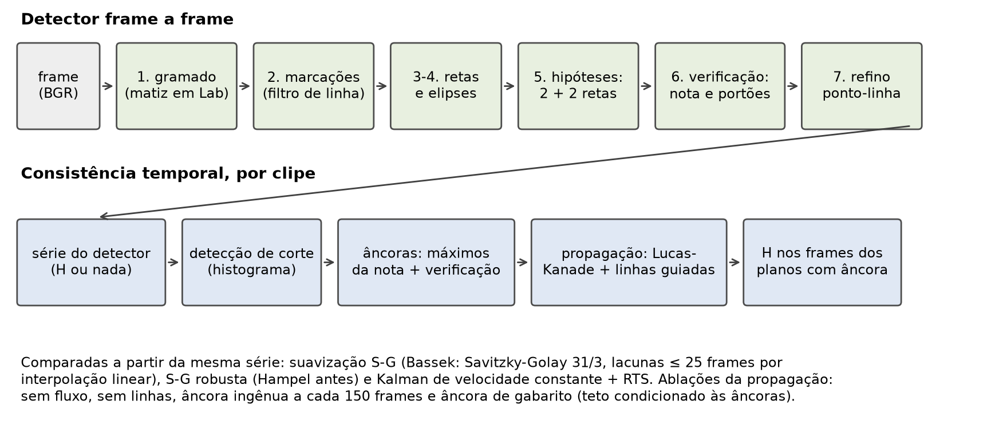
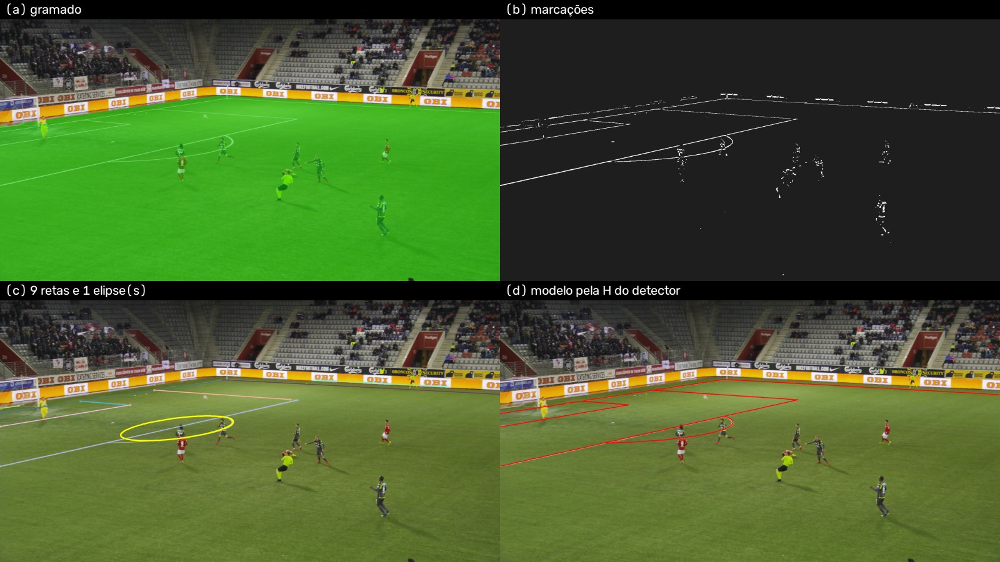
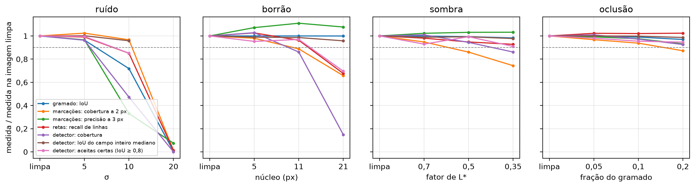
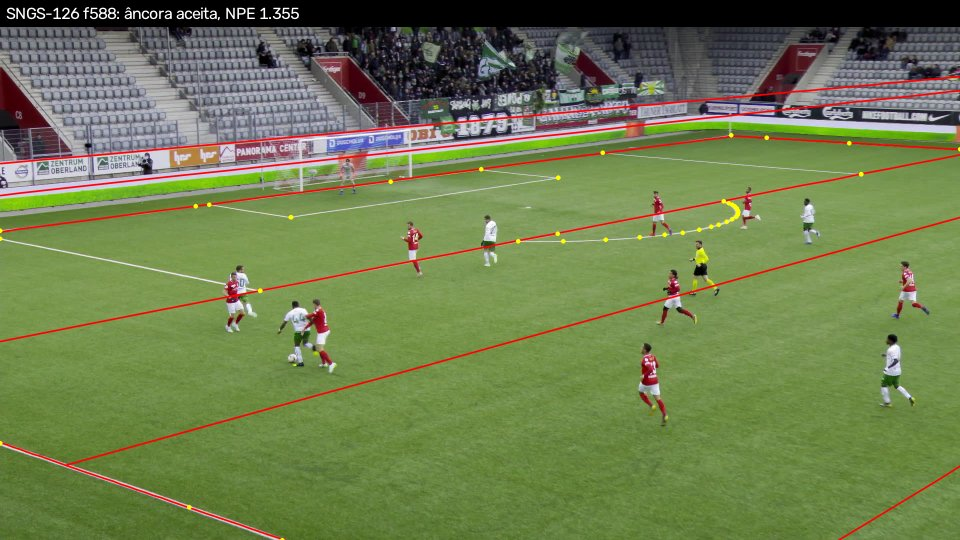
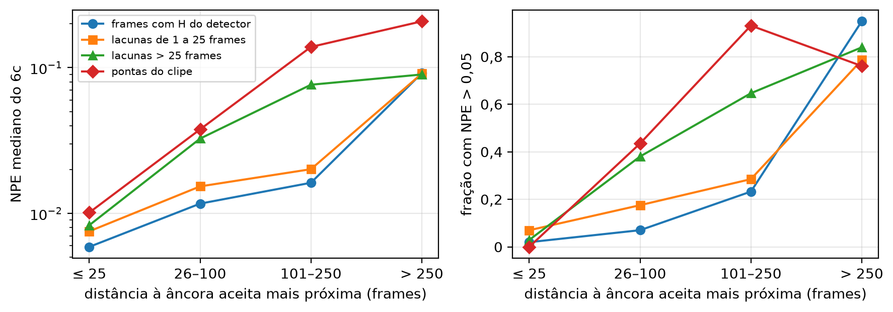
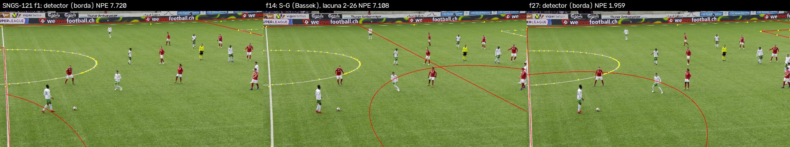

# Resumo

Este trabalho estima a homografia entre o gramado e o frame de uma transmissão de futebol só com processamento digital de imagens clássico, sem redes neurais, e mede quanto a propagação temporal por fluxo óptico recupera das falhas desse detector. O detector segmenta o gramado pelo matiz, realça as marcações com um filtro de linha, detecta retas por Hough e elipses, forma hipóteses com duas retas de cada uma de duas famílias de paralelas, verifica-as contra a imagem e refina a melhor por um ajuste ponto-linha; cada etapa entrou por uma medição na partição de treino. A propagação parte de âncoras verificadas e leva a homografia aos frames vizinhos com Lucas–Kanade.

Na rodada única e limpa no test do SoccerNet-GSR (49 clipes de 3 jogos), o detector produz homografia em 0,505 dos frames, com LocSim@5 penalizado de 0,419. Com a propagação, a cobertura sobe para 0,897 e o LocSim@5 penalizado para 0,749 (mín.–máx. entre os 3 jogos: 0,650–0,920). Nos frames que o detector cobre, a propagação reduz o erro residual em cerca de 40%, fração parecida com os cerca de 38% que o AuxFlow tira de um detector treinado no test inteiro (comparação indicativa, em conjuntos diferentes): o ganho a mais sobre o detector fraco vem de preencher os frames sem homografia, e não de corrigir homografias. Entre as estratégias de consistência temporal, o filtro de Kalman dá a série mais lisa, e a propagação é a que melhor acompanha o movimento real da câmera e a que menos inverte a visibilidade dos jogadores.

A análise de falhas dessa rodada mostrou que as vistas do meio-campo ficavam sem âncora. Um segundo ciclo, decidido em seis jogos de desenvolvimento com critério fixado antes, mediu seis mudanças: aceitou duas (B1 e A'), recusou três (C, B2, B1b) e parou uma na checagem barata (A, redesenhada como A'); as recusas entram como resultado. No mesmo test, a segunda versão chega a 0,902, um número **exploratório**: a hipótese que o produziu nasceu da análise de falhas do próprio test. Na comparação indicativa com a tabela 7 do AuxFlow (0,929), nenhuma das duas versões alcança o estado da arte, numa métrica em que a própria homografia de gabarito ajustada às linhas pintadas tira só 0,946.

# 1. Introdução

Para levar um pixel de uma transmissão de futebol a uma coordenada em metros no campo, é preciso estimar a transformação entre a imagem e o gramado. Como o gramado é aproximadamente plano, essa transformação é uma homografia: uma matriz 3 × 3 com oito graus de liberdade, determinada por no mínimo quatro correspondências (Hartley & Zisserman, 2004†). As marcações do campo são padronizadas, mas três dificuldades tornam o problema difícil na prática:

- as marcações são esparsas, concentradas nas grandes áreas e no círculo central, e há regiões extensas do gramado sem nada a detectar;
- uma câmera de transmissão pode ter zoom de até 25× (Magera et al., 2025, p. 3), e um plano fechado pode não mostrar marcação nenhuma;
- a estimativa feita frame a frame é instável, e o tremor entre frames inviabiliza usos como inserir grafismo ou derivar a velocidade de um jogador a partir da posição.

A área migrou para detectores de pontos-chave treinados (Seção 2). Este trabalho faz a pergunta oposta:

> Até onde chega um pipeline de registro de campo puramente clássico — cor, morfologia, Hough, ajuste de cônica, RANSAC — e quanto da diferença para o estado da arte a propagação temporal por fluxo óptico consegue fechar?

A hipótese é que a propagação tenha ganho marginal maior sobre um detector fraco do que sobre um forte: se o detector acerta metade dos frames, os frames bons podem sustentar os ruins. O resultado das âncoras ingênuas do AuxFlow (Seção 2) indica a condição: isso só vale se as âncoras forem bem escolhidas. Se a hipótese se confirmar, um sistema leve e sem GPU pode ser viável para aplicações offline.

A segunda pergunta vem de Bassek et al. (2025), que suavizaram a série de homografias de transmissões reais sem ter testado o efeito disso sobre a consistência temporal:

> Qual das três estratégias de consistência temporal — suavização da série de homografias, filtragem por Kalman, propagação por fluxo óptico — entrega mais estabilidade, e a que custo?

O trabalho mede também a consequência prática do erro de registro, seguindo o mesmo artigo: com que frequência o registro troca o rótulo de visibilidade de um jogador, colocando fora do quadro quem está dentro.

**Como ler os números.** Há duas rodadas no mesmo test, com estatutos diferentes, e todo número do test leva o rótulo da sua.

- **v1, rodada limpa.** O método foi calibrado só nas partições de treino, congelado num commit antes de qualquer número do test e rodado uma vez. É a estimativa limpa deste trabalho; as Seções 6 e 7 são dela.
- **v2, exploratória (test já visto no v1).** Um segundo ciclo de melhorias, decidido só em jogos de desenvolvimento, mas cuja hipótese principal nasceu da análise de falhas do test do v1 (Seção 7). O número dele no test não é uma estimativa limpa de generalização (Seção 8).
- **Análise posterior à rodada.** Medidas acrescentadas depois da rodada do v1, a partir dos caches dela e sem mudar parâmetro nenhum (Seção 5).

A comparação com o AuxFlow, nas duas versões, é **indicativa**: o artigo dele não diz como agrega o LocSim nem como entram os frames sem homografia (Seção 4).

As contribuições são:

1. um detector frame a frame sem aprendizado profundo, avaliado no WC14 e no SoccerNet-GSR, com o ganho de cada etapa medido no treino;
2. a medição do ganho da propagação de Lucas–Kanade sobre esse detector fraco, com ablações (sem fluxo, sem linhas, âncora ingênua, âncora de gabarito) e uma comparação com o AuxFlow no subconjunto difícil HSB;
3. a comparação das três estratégias de consistência temporal em estabilidade e em inversão de visibilidade;
4. um protocolo com calibração só no treino, congelamento do código e uma rodada única no test, com determinismo conferido bit a bit;
5. um segundo ciclo de melhorias com plano e critério de aceite congelados antes do primeiro experimento, em que só duas das seis mudanças medidas foram aceitas, e cujas recusas são relatadas com os números.

O texto segue a ordem: trabalhos relacionados (Seção 2), método (Seção 3), dados e métricas (Seção 4), protocolo (Seção 5), resultados do v1 (Seção 6), análise de falhas do v1 (Seção 7), o segundo ciclo (Seção 8), discussão e limitações (Seção 9) e conclusão (Seção 10). Os comandos de reprodução estão no Apêndice A. As tabelas completas das duas rodadas estão nos relatórios do projeto (`docs/04-relatorio.md` e `docs/04-relatorio-v2.md`), e a origem de cada número deste texto, em `docs/trabalho-final-numeros.md`.

# 2. Trabalhos relacionados

As citações sem marca são dos artigos do projeto, com a frase conferida no PDF. As marcadas com † são **referências herdadas do relatório v1**, não conferidas em PDF neste trabalho: os métodos clássicos e os trabalhos que só aparecem de segunda mão, pelo que outros artigos dizem deles.

**Detectores treinados.** O PnLCalib (Gutiérrez-Pérez & Agudo, 2026) usa uma rede HRNetv2 que produz mapas de calor sobre uma grade hierárquica de pontos derivada geometricamente do campo. As correspondências incluem interseções diretas de linhas, interseções de linhas prolongadas, interseções de linha com elipse, pontos de tangência e pontos auxiliares no eixo central; na ablação dos autores, cada conjunto aumenta a cobertura. O módulo de refinamento otimiza pontos e linhas em conjunto, e o ganho do refino vem das linhas: refinar só com pontos quase não muda o resultado. O BroadTrack (Magera et al., 2025) modela fisicamente a lente e o tripé da câmera de transmissão; na ablação dele no GSR, o maior ganho vem de incluir a distorção radial no modelo de câmera, e o rastreamento é reiniciado quando a confiança, o IoU entre as marcações detectadas e o modelo projetado, cai abaixo de 0,5. Segundo a avaliação do AuxFlow (tabela 7), no GSR o BroadTrack tem o maior IoU do campo inteiro (0,8397 contra 0,8352 do AuxFlow), mas perde no IoU da parte visível (0,9224 contra 0,9426) e no erro de reprojeção em metros (1,34 contra 0,84 m).

**Propagação temporal.** O AuxFlow (Ziegler et al., 2026) é a referência central deste trabalho. Ele parte do NBJW (Gutiérrez-Pérez & Agudo, 2024†), que o artigo descreve como o modelo de detecção de pontos-chave de código aberto do estado da arte, e escolhe frames-âncora com uma heurística sobre a confiança dos pontos-chave e uma métrica substituta de IoU. A partir de cada âncora, amostra uma grade regular de 2,5 × 2 m de pontos auxiliares do campo, rastreia-os com Lucas–Kanade com verificação de ida e volta (erro ≤ 1 px) e reestima a homografia com os pontos-chave do NBJW e os pontos propagados. Os números do artigo que importam aqui:

- no subconjunto difícil HSB do GSR, partindo da homografia de gabarito, o LocSim médio é 83,67%; sem o fluxo, cai para 23,42%, e sem os pontos-chave do detector, para 78,30%;
- o Lucas–Kanade venceu o RAFT (83,67 contra 78,71), porque retém mais que o dobro de pontos; a grade regular vence a amostragem geométrica (39,68) e empata com a aleatória (83,39);
- a escolha das âncoras é decisiva: no GSR, âncoras a cada 150 frames (82,48) ficam abaixo do detector sem propagação (83,48), a melhor heurística chega a 90,65 e a âncora de gabarito a 91,88;
- com a homografia inicial perturbada, a propagação ainda chega a 54,74 contra 43,15 do detector sozinho;
- na tabela 7, no GSR test, o LocSim@5 é 0,885 para o NBJW e 0,929 para o AuxFlow.

A propagação sempre foi avaliada acoplada a um detector forte; o ganho dela sobre um detector inteiro fraco não tinha sido medido.

**Filtragem e suavização.** O BHITK (Claasen & de Villiers, 2024†) é descrito aqui pelo que o AuxFlow diz dele: relaciona a homografia de um frame à do seguinte, com um filtro de Kalman; a implementação do AuxFlow sobre o NBJW melhorou levemente o NBJW no TSWC (texto, seção 5.6) e deu diferença desprezível no GSR (tabela 7: 0,8852 contra 0,8851). Bassek et al. (2025) usaram o TVCalib (Theiner & Ewerth, 2023†) para estimar a região visível do campo em transmissões reais e suavizaram a série das homografias com um filtro de Savitzky–Golay de janela 31 e grau 3, preenchendo antes lacunas de até 25 frames por interpolação linear. Os autores registram que o efeito desse pós-processamento sobre a consistência temporal e sobre frames difíceis, como os de zoom grande, não tinha sido testado; a validação foi qualitativa. Eles contaram em média 981 cortes por partida (10,9 por minuto). No feed de scouting, segundo a inspeção visual deles (p. 8), o próprio pipeline de detecção do campo de visão e de filtragem introduziu poucos artefatos, em que só um jogador fica visível (1% do material) ou nenhum (3%).

**Métodos clássicos e avaliação.** Farin et al. (2004†) calibram a câmera em vídeo de esporte a partir das retas da quadra: as retas detectadas por Hough são separadas em duas direções, pares de cada direção são atribuídos às linhas do modelo, e cada atribuição é avaliada pela concordância do modelo projetado com a imagem. A geração de hipóteses deste trabalho segue essa ideia. O levantamento de Manafifard et al. (2017) trata a detecção do gramado como a primeira etapa canônica do rastreamento de jogadores, por histograma de cor ou mistura de gaussianas, e relata vantagem para a mistura. Maglo et al. (2023) observam que, com pontos-chave em grade uniforme no campo, o RANSAC tende a escolher pontos do lado distante, concentrados na imagem, e propõem uma amostragem que acompanha a perspectiva. Citraro et al. (2020) desaconselham o IoU medido só na parte visível do campo. Os números publicados usam moldes de campo diferentes: o PnLCalib avalia o WC14 em 115 × 74 jardas, e o KpSFR (Chu et al., 2022†) e Maglo et al. (2023), em 100 × 60 m. O IoU do campo inteiro e o erro em metros dependem do molde.

# 3. Método

O pipeline tem duas partes (Figura 1): um detector que estima a homografia em cada frame, isoladamente, e uma etapa temporal que usa a série do detector num clipe. A homografia é sempre tomada no sentido campo → imagem, com o campo em metros, a origem no centro e Y positivo em direção à câmera principal. O modelo do campo tem 105 × 68 m, com as marcações das Regras do Jogo. Todas as constantes estão no `config.yaml`, cada uma com a origem: artigo, norma do campo ou calibração na partição de treino. Esta seção descreve o método do v1; as duas mudanças aceitas no v2 (um limiar de nota nas âncoras e hipóteses de vista central) estão na Seção 8.



## 3.1 Detector frame a frame

A regra do projeto é que cada etapa justifique a sua existência com um número, medido só no treino. A Tabela 1 traz essas medições, e a Figura 2 mostra as etapas num frame do treino.

1. **Gramado.** Converte-se o frame para Lab e mede-se o ângulo de matiz em (a\*, b\*) em relação ao pico do próprio frame, o que absorve o balanço de branco de cada transmissão. O gramado são os pixels a até 20° do pico, com croma mínimo, seguidos de abertura, fechamento, maior componente conexo e preenchimento de buracos (Gonzalez & Woods, 2018†). O espaço de cor foi escolhido pelo IoU contra as máscaras anotadas do WC14, e cada operação morfológica ficou porque subiu esse IoU (Tabela 1): o maior componente conexo é a que mais pesa. Com os tamanhos finais dos elementos estruturantes, o IoU médio no WC14 de treino é 0,9861.
2. **Marcações.** Um filtro de linha marca o pixel significativamente mais claro, em L\*, que os vizinhos a uma distância proporcional à largura esperada da linha naquela altura da imagem, dos dois lados. Venceu o top-hat morfológico nas duas bases (Tabela 1). O filtro só atua dentro do gramado dilatado. O limiar de contraste foi calibrado em cada base no próprio treino: 15 no WC14 e 30 no GSR.
3. **Retas.** Transformada de Hough (Duda & Hart, 1972†) na versão probabilística (Matas et al., 2000†), um filtro de forma que retira os componentes compactos (jogadores) e a fusão de segmentos colineares. As duas operações foram medidas: o filtro de forma sobe o F1 dos segmentos, e sem a fusão uma linha do campo vira vários fragmentos (Tabela 1).
4. **Elipses.** Candidatas formadas por trios de cordas curtas vizinhas, reajustadas por mínimos quadrados (`cv2.fitEllipse`, que segue Fitzgibbon & Fisher, 1995†) e aceitas por apoio, forma e uma âncora geométrica: uma reta que cruza a elipse perto do centro, no círculo central, ou as pontas do arco junto à linha da grande área. O centro da elipse projetada nunca vira correspondência, porque a perspectiva o desloca do centro do círculo.
5. **Hipóteses.** Os segmentos são agrupados em duas famílias pelos pontos de fuga. Como em Farin et al. (2004†), duas retas de cada família, entre as mais longas, são atribuídas a linhas do modelo da mesma família, respeitando a ordem, e as quatro interseções dão uma homografia (Hartley & Zisserman, 2004†). A simetria de 180° do campo é desfeita pela convenção de que Y cresce em direção à câmera. **Essa geração de hipóteses exige 2 + 2 retas de duas famílias de paralelas**, o ponto que mais limita o detector (Seção 7).
6. **Verificação.** Cada hipótese recebe uma nota com três termos, cada um entre zero e um, com pesos iguais: a fração dos segmentos explicada pelo modelo projetado, a fração do modelo projetado sobre o gramado que cai numa marcação e o IoU entre o campo projetado e o gramado da etapa 1. A melhor hipótese só é aceita se passar por dois portões, fração explicada ≥ 0,45 e IoU ≥ 0,85. Os portões não foram ajustados olhando imagens: ficam logo abaixo do percentil 5 que a homografia de gabarito atinge no treino.
7. **Refino.** A melhor hipótese é refinada por um ajuste ponto-linha com perda robusta: os pixels da máscara de marcações numa faixa em volta de cada linha do modelo projetado são levados às linhas, e os círculos entram pela distância de Sampson à cônica projetada (Sampson, 1982†; Hartley & Zisserman, 2004†). O ajuste aceita só soluções bem determinadas. As elipses são conferidas depois da homografia; uma elipse rejeitada devolve as suas cordas às retas, e o frame é reclassificado uma vez.

Sem quatro retas utilizáveis, ou sem hipótese que passe nos portões, o frame é reportado como falha de cobertura: nenhuma homografia é inventada.

<!-- copia: docs/04-relatorio.md | Tabela 1 — Contribuição -->
| Etapa | Comparação | Medida, partição de treino | Resultado |
|---|---|---|---|
| Gramado: espaço de cor | ângulo de matiz em Lab × HSV × distância em Lab | IoU do gramado, WC14 (média / com sombra) | 0,9838 / 0,9797 × 0,9822 / 0,9764 × 0,9728 / 0,9319 |
| Gramado: pós-processamento | cru → + abertura → + fechamento → + maior componente → + preenchimento | IoU do gramado, WC14 | 0,9441 → 0,9492 → 0,9548 → 0,9763 → 0,9838 |
| Marcações | filtro de linha × top-hat | F1 a 3 px, WC14 (GSR) | 0,579 × 0,560 (0,634 × 0,577) |
| Retas: filtro de forma | com × sem | F1 dos segmentos, GSR | 0,641 × 0,597 |
| Retas: fusão de segmentos | com × sem | fragmentação (F1), GSR | 1,17 × 4,70 (0,641 × 0,634) |

: Tabela 1 — Contribuição de cada etapa de PDI, medida na calibração, só nas partições de treino (WC14 `train_val`, GSR `train`). A sombra é o subconjunto do WC14 com sombra, definido por regra sobre um limiar de Otsu (1979†) no L\*. Fragmentação: segmentos por linha do campo detectada. Copiada do relatório v1.
<!-- fim: copia -->

**As etapas de elipses a refino (calibração no treino/valid).** Essas etapas foram medidas durante a construção do detector, no GSR train, e as medidas estão no registro de decisões do projeto (`docs/decisoes.md`), não nos relatórios. A Tabela 2 as reúne, com o rótulo "calibração no treino/valid"; a origem de cada número é a linha do registro.

| Etapa | Comparação | Conjunto | Resultado |
|---|---|---|---|
| Elipses, detectadas às cegas (sem homografia) | precisão; recall do círculo central; recall dos arcos | GSR train | 0,668; 0,740 (643 visíveis); 0,202 (1.105 visíveis) |
| Retas: tolerância da fusão e escala | cobertura / NPE mediano / NPE médio: td 3/720 e escala 1 × td 6/720 e escala 1 × td 3/720 e escala 1+2 × td 6/720 e escala 1+2 | GSR train, 1.697 frames | 0,388 / 0,0057 / 3,05 × **0,418 / 0,0064 / 0,58** × 0,339 / 0,0060 / 0,71 × 0,398 / 0,0060 / 1,02 |
| Verificação: a nota | a homografia de gabarito, injetada entre as hipóteses, vence | subconjunto de 60 frames | 31 de 37 frames (84%) |
| Verificação: os portões | homografias barradas, por variante de refino | subconjunto de 60 frames | 9 / 6 / 4, todas erradas (NPE de 0,48 a 300) |
| Refino | cobertura / NPE mediano / aceitas erradas: só a hipótese × refino pelos segmentos × **refino guiado** pela máscara | subconjunto de 60 frames | 0,483 / 0,0216 / 10 × 0,467 / 0,0076 / 8 × **0,433 / 0,0062 / 6** |
| Elipses conferidas depois da homografia | 33 elipses, 10 falsas pelo gabarito; 7 rejeitadas | subconjunto de 60 frames | cobertura, NPE e aceitas erradas iguais (0,433; 0,0058; 6) |
| Correspondências + RANSAC antes do refino | cobertura / NPE médio / aceitas erradas: sem → com | subconjunto de 60 frames | 0,433 → 0,417; 0,200 → 0,226; 6 → 5 (NPE mediano igual, 0,0058) |

: Tabela 2 — Medidas das etapas de elipses a refino, calibração no treino/valid (GSR train; o subconjunto tem 60 frames de clipes do treino). td é a tolerância de distância da fusão de retas, em fração da altura da imagem; a variante escolhida está em negrito. Origem: `docs/decisoes.md`, entradas de 2026-09-28 das Fatias 4 e 5 (linha de cada número em `docs/trabalho-final-numeros.md`).

O que as medidas dizem:

- **Elipses às cegas são fracas**, e por isso o detector não as usa para gerar hipóteses: um terço das elipses detectadas é falso e os arcos das grandes áreas quase não aparecem (recall de 0,202). O círculo entra no refino pela cônica projetada pela própria hipótese, e não pela elipse detectada, e a elipse só é conferida depois da homografia.
- **A tolerância da fusão e a escala foram decididas pelo erro da homografia**, com a regra fixada antes: menor NPE mediano com cobertura dentro do ruído. A td 3/720 com escala única tem o menor NPE mediano, mas perde 0,030 de cobertura, além do ruído de 0,01; a escolhida, td 6/720 com escala única, também tem o menor NPE médio, ou seja, menos homografias erradas aceitas. A multiescala perde cobertura.
- **A nota e os portões fazem o que devem.** Com a nota de três termos, a homografia de gabarito vence as hipóteses em 31 de 37 frames, e as derrotas são quase empates. Os portões só barraram homografias erradas. As aceitas erradas que sobram passam pelos portões, o que a Seção 7 retoma.
- **O refino guiado foi decidido pelo NPE.** Contra o refino pelos segmentos detectados, baixa o NPE mediano de 0,0076 para 0,0062 e as aceitas erradas de 8 para 6, ao custo de cobertura (0,467 → 0,433).
- **Duas etapas são neutras.** A conferência das elipses depois da homografia não mudou cobertura, NPE nem aceitas erradas, e ficou porque o plano a pedia e não custa nada. As correspondências de pontos com RANSAC (Fischler & Bolles, 1981†) antes do refino também foram neutras e ficaram fora do caminho principal, de acordo com o PnLCalib, em que o ganho do refino vem das linhas.

**O que continua sem medida.** A geração de hipóteses e o refino são estruturais: sem eles não há homografia, e não há ablação "sem" a medir. A geração tem um teto medido, que antecipa a limitação principal do detector: no mesmo subconjunto, a hipótese certa era possível em 37 dos 60 frames, e a geração pôs 2 + 2 retas certas entre as candidatas em só 24 deles; o que falta são retas certas postas na família errada. O efeito do detector inteiro aparece nos resultados (Seção 6.1), e a sua robustez etapa a etapa, na Seção 6.9.



## 3.2 Consistência temporal

O detector roda em todos os frames de cada clipe, e a série resultante (homografia ou nada, por frame) alimenta as estratégias abaixo. Todas partem da mesma série, o que torna a comparação direta.

- **Suavização S-G (Bassek).** A versão de Bassek et al. (2025), na nossa implementação: lacunas de até 25 frames preenchidas por interpolação linear dos nove elementos da matriz normalizada, seguidas de Savitzky–Golay (Savitzky & Golay, 1964†) de janela 31 e grau 3. A **S-G robusta** aplica antes um filtro de Hampel (Hampel, 1974†) na representação por pontos, que descarta homografias discrepantes da vizinhança; a janela e o limiar foram calibrados no treino.
- **Kalman + RTS.** Filtro de Kalman (Kalman, 1960†) de velocidade constante com o suavizador RTS (Rauch et al., 1965†). É uma versão simplificada, e não o BHITK. Roda sobre as coordenadas no campo de quatro pontos fixos da imagem, com uma porta de Mahalanobis contra homografias erradas; os ruídos de processo e de medição foram calibrados no treino.
- **Detecção de corte.** A distância de Bhattacharyya (1943†) entre histogramas HSV de frames consecutivos, na forma de Hellinger que o OpenCV calcula, detecta os cortes, e nenhuma estratégia atravessa um corte. O limiar foi calibrado no treino com cortes sintéticos.
- **Propagação por Lucas–Kanade.** As âncoras candidatas são os máximos locais da nota do detector, em ±12 frames. Cada candidata passa por uma verificação temporal: a homografia dela, levada pelo movimento que o Lucas–Kanade mede, tem que concordar com a do detector em pelo menos 2 vizinhos, com maioria. Cada frame recebe a homografia da âncora mais próxima do mesmo plano (entre cortes), propagada nos dois sentidos do tempo. A cada frame, uma grade de 2,5 × 2 m de pontos do campo, projetada pela homografia corrente, é rastreada por Lucas–Kanade (Lucas & Kanade, 1981†) piramidal (Bouguet, 2001†) com verificação de ida e volta (Kalal et al., 2010†; erro ≤ 1 px), sem os pontos sobre jogadores e bola (os componentes compactos de não-gramado). A homografia é reestimada com os pontos rastreados e com os pixels das marcações em volta das linhas do modelo projetado. **A saída da propagação é a homografia propagada e reestimada**; a do detector só entra na escolha e na verificação das âncoras. Um plano sem âncora fica sem homografia.

Os componentes da propagação também precisam justificar a sua existência, e cada um tem uma ablação, medida no test (Seção 6.2):

- **propagação sem fluxo:** a homografia da âncora copiada até o meio do caminho entre âncoras; mede o que o rastreamento acrescenta;
- **propagação sem linhas:** só os pontos rastreados na reestimativa; mede o que as linhas acrescentam;
- **âncora ingênua:** a primeira homografia do detector em cada bloco de 150 frames, sem verificação; mede o que a escolha das âncoras acrescenta, como no experimento do AuxFlow;
- **âncora de gabarito:** a homografia de gabarito nos mesmos frames das âncoras verificadas, com a mesma propagação.

A âncora de gabarito separa o erro da âncora do erro da propagação, dado onde as âncoras estão. É um **teto condicionado às âncoras**, e não o limite do sistema: herda os frames escolhidos pelo detector, e um clipe sem âncora fica fora dele também. O **teto do sistema**, com âncoras de gabarito escolhidas sem o detector, é uma análise posterior à rodada (Seção 6.2).

# 4. Dados e métricas

## 4.1 Dados

**WC14** (Homayounfar et al., 2017†): 209 imagens de treino e 186 de teste, de jogos diferentes da Copa do Mundo de 2014, em 1280 × 720, com homografia anotada à mão e máscara do gramado. As imagens não estão em sequência e servem para avaliar só o detector.

**SoccerNet-GSR** (Somers et al., 2024): clipes de 750 frames consecutivos a 25 fps, em 1920 × 1080, da câmera principal, com 57 clipes de treino, 58 de validação e 49 de teste. Cada partição tem 3 jogos; o test tem os jogos 7, 8 e 11, com 16, 19 e 14 clipes. O arquivo não traz parâmetros de câmera. Traz as linhas do campo anotadas na imagem e, para cada pessoa, a caixa na imagem e a posição no campo (`bbox_pitch`), que vem da calibração do próprio dataset, e não das linhas anotadas.

- **Gabarito.** A homografia de gabarito de cada frame é um ajuste ponto-linha às linhas anotadas, com aceite só quando bem determinado. É a referência do NPE, do IoU e da classificação das âncoras em certas ou erradas (NPE > 0,05).
- **O gabarito e o detector não são independentes.** O gabarito é produzido pela mesma função de ajuste ponto-linha que refina a hipótese do detector (Seção 3.1, etapa 7), e os dois usam homografia pura, sem modelo de lente. Onde a lente curva as linhas, os dois tendem a errar do mesmo jeito, e o NPE e o IoU contra esse gabarito favorecem o método. Por isso entra também a acurácia contra as linhas anotadas, que não usa gabarito nenhum.
- **O limite do LocSim para quem acerta as linhas.** O LocSim mede contra o `bbox_pitch`, e a calibração do dataset não coincide com as linhas anotadas. A nossa homografia de gabarito, ajustada às linhas, tira só 0,946 de LocSim@5 no test (análise posterior à rodada; 0,933 no train, medido antes da rodada). O gabarito do AuxFlow tira 0,9928 de média (tabela 2 deles), e a leitura de RANSAC sobre as pessoas reproduz a mediana e a distância da tabela 2 deles, mas não a média: a nossa reprodução (abaixo) tira 0,978 no test. Um método que acerte as linhas pintadas fica, portanto, perto de 0,946 nessa métrica. Esse limite pesa em toda comparação com o AuxFlow.
- **Correções de rótulo.** Foram corrigidas trocas de classe na anotação das linhas, achadas por uma varredura do gabarito, sem nenhuma saída do método. Sete clipes do test têm correção. Elas não afetam o LocSim, que usa as posições anotadas das pessoas, e sim o NPE e o IoU contra o gabarito.
- **Protocolo do AuxFlow.** Para comparar com o AuxFlow, usa-se também a `H_gt_auxflow`: RANSAC (3 px) sobre os pés das pessoas e as posições delas no campo, que reproduz a mediana e a distância da tabela 2 do AuxFlow, mas não a média. É a homografia inicial da medição de "só propagação" no HSB.
- **HSB.** O subconjunto difícil do AuxFlow (tabela 3 deles) tem 10 clipes, todos no test, cada um com um intervalo de frames e o LocSim@5 do NBJW. Os intervalos foram transcritos do artigo, com duas suposições registradas: a numeração a partir de 0 e a leitura do intervalo "90–0" do SNGS-128 como 0–90, propagado de trás para frente.

## 4.2 Métricas

- **LocSim@5.** É a similaridade de localização do GSR (Somers et al., 2024, equação (4)): o pé de cada pessoa anotada vai ao campo pela inversa da homografia estimada, e a similaridade é exp(ln(0,05)·d²/τ²), com τ = 5 m e d a distância à posição anotada. Não depende do gabarito. O **penalizado** divide a soma das similaridades pelo total de pessoas de todos os frames: a pessoa de um frame sem homografia vale 0. O LocSim **nos cobertos** usa só os frames com homografia; é otimista, porque premia quem só responde nos frames fáceis. O **mAP-LocSim** é a média de τ = 1 a 10 m. O agregado é sobre pessoas-frame. É a métrica de decisão do v2 e a da comparação com o AuxFlow.
- **Geometria.** NPE: deslocamento na imagem, dividido pela altura, dos pontos de uma grade de 2,5 × 2 m do campo visíveis pelo gabarito. IoU do campo inteiro (vista de cima) e IoU da parte visível (na imagem), este com a ressalva de Citraro et al. (2020). No WC14, também o erro em metros e o protocolo do KpSFR, com o código deles sem mudança.
- **Acurácia contra as linhas anotadas** (protocolo do SN-Calib, com a contagem do código deles). Em 960 × 540, cada classe de linha anotada e projetada no quadro conta como acerto se todos os seus pontos anotados estão a menos de 5, 10 ou 20 px da linha projetada pela homografia estimada; classe projetada e não anotada, ou anotada e não projetada, conta como erro. É a única medida geométrica que não depende de gabarito nenhum. A **penalizada** dá 0 ao frame sem homografia.
- **Cobertura.** A fração de frames (ou imagens) com homografia.
- **Estabilidade,** medida na série estimada e nunca contra o gabarito, que tem tremor próprio. O **tremor** é a segunda diferença, em pixels, dos pontos visíveis de uma grade do campo. O **deslize** é a distância entre o movimento que a série implica e o movimento real da imagem, medido por ECC (Evangelidis & Psarakis, 2008†): um método independente do Lucas–Kanade da propagação, para que a medida não seja circular.
- **Visibilidade,** seguindo Bassek et al. (2025). O polígono do campo de visão é levado ao campo pela homografia estimada e pela de gabarito. Mede-se a fração de jogadores-frame que o registro joga para fora do quadro (unilateral, porque o GSR só anota quem está no quadro), a fração de pontos de uma grade do campo com rótulo trocado e a fração de frames em que o registro deixa 0 jogadores visíveis.

**O que o artigo do AuxFlow permite verificar.** O LocSim não usa homografia de gabarito, nem lá nem aqui. Sobre o número deles, o artigo diz que o conjunto é o split de test do GSR (seção 5.6), o mesmo dos nossos 49 clipes, mas não diz se usou todos os clipes e frames. A legenda da tabela 7 diz que as métricas são calculadas por frame e que depois se tiram a média e a mediana; a coluna do LocSim@5 traz um valor só, sem dizer qual dos dois. O artigo também não diz como entram os frames sem homografia. Uma frase do relatório v1 afirmava que o LocSim deles não tem esses frames; ela não tem apoio no artigo e foi corrigida na errata do adendo v2. Por isso a comparação é indicativa.

# 5. Protocolo experimental

**Partições.** Todo parâmetro empírico do v1 foi calibrado só no treino (WC14 `train_val`, GSR `train`). A validação do GSR serviu só para relatório, com uma exceção registrada: na calibração da segmentação, ela escolheu entre variantes, e nenhuma passou. O WC14 test e o GSR test ficaram intocados até a rodada final.

**Incerteza.** Clipes do mesmo jogo não são independentes, e a incerteza é tomada entre jogos, com bootstrap sorteando jogos (2.000 reamostragens, semente fixa). Com 3 jogos, há só 10 reamostragens distintas, e o intervalo de 95% desse bootstrap é o mínimo e o máximo entre os jogos. O texto o reporta como tal, "mín.–máx. entre os 3 jogos", e a leitura principal é por jogo.

**Congelamento e rodada única.** Antes da rodada, o código e o config foram congelados num commit, com o SHA-1 do config e as chaves de cache registradas, e cada etapa da rodada conferiu esse congelamento antes e depois. Valia a regra de que nenhum parâmetro muda depois de ver um número do test, e de que um defeito no meio obriga a refazer o test inteiro, declarando a segunda rodada. Houve uma rodada só.

**Determinismo.** Nos 1.470 frames do GSR test a cada 25, a homografia do detector rodado numa etapa saiu bit a bit igual à da série gerada noutra etapa, noutro processo e noutra hora.

**Um incidente.** A conferência de fechamento da série quebrou depois que a série terminou, porque passava a tupla da tarefa no lugar do clipe. Nada foi corrigido durante a rodada. A conferência foi feita por fora, com o mesmo critério (735/735 chaves iguais à congelada), e a rodada seguiu. Não houve segunda rodada porque nenhum número do test tinha sido visto, o defeito estava numa conferência e não no cálculo, e a prova bit a bit da etapa seguinte confirmou que as séries eram as do código congelado. A correção veio depois, num commit separado, e não muda nenhuma saída.

**Dois defeitos de chave achados depois da rodada.** A revisão de código de 2026-10-14 achou dois defeitos nos caches do v1: a série do detector é lida sem conferir a chave gravada, e as chaves da série, do 6c e do ECC não incluem todos os parâmetros e arquivos de que o cálculo depende. Eles não afetaram os números, porque na rodada todas as chaves foram conferidas (735/735 da série e 49/49 do 6c), e foram corrigidos no `src_v2`, com as chaves regravadas só depois de uma conferência bit a bit contra os caches do v1 (`docs/decisoes.md` e README, "Limitações conhecidas").

**Análises posteriores à rodada.** Depois de uma revisão externa do texto do v1, cinco medidas foram acrescentadas: o LocSim das homografias de gabarito como predição, a suavização S-G no HSB, a acurácia contra as linhas anotadas, o teto do sistema e a robustez do detector a degradações sintéticas, esta só no WC14 de treino. Todas saem dos caches da rodada, por um script fora do código congelado, chamando as funções dele sem mudança, e nenhum parâmetro mudou. No texto, cada uma vem marcada.

**Defeitos silenciosos, como resultado de método.** As conferências da sensibilidade e da rodada de validação acharam cinco defeitos que não quebravam nada e mudavam números, todos corrigidos antes do congelamento:

- a chave de cache da propagação era lida do arquivo-fonte na hora da gravação, e uma edição no meio da rodada gravou 47 caches da validação com a chave errada (recalculados);
- a sensibilidade perturbava um parâmetro de fusão de retas que o detector não lia, porque a variante do detector o sobrescrevia;
- um objeto da GPU guardado por processo ignorava a perturbação de outro parâmetro;
- a perturbação do ajuste chegava ao próprio gabarito, carregado dentro da troca de parâmetros;
- o LocSim penalizado virava NaN num recorte sem nenhuma homografia, quando pela definição vale 0.

Dois foram denunciados por uma variação exatamente nula. A lição geral: estado derivado precisa de chave completa, o gabarito se carrega fora de qualquer perturbação, e uma variação exatamente nula pede prova de que o parâmetro é lido. O protocolo do segundo ciclo, que acrescenta um plano congelado e um critério de aceite por jogo, está na Seção 8.

# 6. Resultados do v1 (rodada limpa)

Todos os números desta seção são do test, na rodada única do v1, salvo indicação; os das análises posteriores à rodada vêm marcados. A Tabela 3 resume o GSR test.

<!-- copia: docs/04-relatorio.md | Tabela 2 — GSR test (49 clipes -->
| Série | Cobertura | NPE mediano | LocSim@5 penalizado | Nos cobertos | Fração ao teto condicionado | Fração ao teto do sistema\* |
|---|---|---|---|---|---|---|
| detector | 0,505 | 0,0072 | 0,419 | 0,869 | — | — |
| suavização S-G (Bassek) | 0,680 | 0,0126 | 0,446 | 0,681 | 0,078 | 0,054 |
| S-G robusta | 0,665 | 0,0097 | 0,478 | 0,747 | 0,171 | 0,117 |
| Kalman + RTS | 0,680 | 0,0113 | 0,490 | 0,749 | 0,207 | 0,142 |
| **propagação** | 0,897 | 0,0105 | **0,749** | 0,833 | **0,959** | **0,656** |
| propagação sem linhas | 0,897 | 0,0122 | 0,715 | 0,796 | 0,861 | 0,588 |
| propagação sem fluxo | 0,897 | 0,1248 | 0,366 | 0,407 | −0,155 | −0,106 |
| âncora ingênua | 1,000 | 0,0262 | 0,571 | 0,571 | 0,442 | 0,303 |
| teto condicionado às âncoras | 0,897 | 0,0064 | 0,763 | 0,849 | — | 0,684 |
| teto do sistema\* | 1,000 | 0,0058 | 0,922 | 0,922 | — | — |

: Tabela 3 — v1, GSR test (49 clipes, 3 jogos). A fração ao teto é (série − detector) / (teto − detector), no LocSim@5 penalizado. O teto condicionado às âncoras parte da homografia de gabarito nos frames das âncoras verificadas. \* Análise posterior à rodada: o teto do sistema parte da homografia de gabarito no primeiro frame com gabarito de cada bloco de 150 frames, com a mesma propagação. Copiada do relatório v1 (Tabela 2).
<!-- fim: copia -->

## 6.1 O detector sozinho

**No WC14 test,** o detector produz homografia em 0,575 das 186 imagens. No protocolo do KpSFR, que a literatura reporta sobre todas as imagens, o IoU do campo inteiro tem média de 0,5155 e mediana de 0,8634, contando como 0 as 79 imagens sem homografia; nas 107 imagens com homografia, média de 0,8962 e mediana de 0,9534. No nosso molde de 105 × 68 m, nas imagens com homografia, o IoU do campo inteiro tem mediana de 0,913 (média 0,864) e o erro em metros, mediana de 0,380 m; a média do erro em metros (1,615 m) revela a cauda de homografias erradas aceitas. O IoU da parte visível, que Citraro et al. (2020) desaconselham, fica como complemento: mediana de 0,995 nas imagens com homografia.

**No GSR test,** o detector cobre 0,505 dos frames, com NPE mediano de 0,0072 e LocSim@5 de 0,869 nos frames cobertos; o LocSim@5 penalizado é 0,419. O detector "pisca": responde em trechos curtos, separados por lacunas curtas e longas (Seção 6.7). A leitura das duas bases é a mesma: quando o detector responde, a homografia costuma ser boa; o que falta é responder.

## 6.2 A propagação e as suas ablações

**Por jogo** (Tabela 4), a propagação sobe o LocSim@5 penalizado de 0,341 para 0,676 no jogo 7, de 0,360 para 0,650 no jogo 8 e de 0,555 para 0,920 no jogo 11. Nos três jogos, ela fica a menos de 0,03 do teto condicionado às âncoras. A cobertura da propagação vai de 0,838 a 1,000. No agregado, o ganho é de +0,330 (mín.–máx. entre os 3 jogos: 0,290–0,365).

<!-- copia: docs/04-relatorio.md | Tabela 3 — GSR test por jogo -->
| Jogo | Clipes (com âncora) | Cobertura: detector / propagação | LocSim@5 pen.: detector | propagação | teto condicionado | teto do sistema |
|---|---|---|---|---|---|---|
| 7 | 16 (14) | 0,472 / 0,874 | 0,341 | 0,676 | 0,703 | 0,919 |
| 8 | 19 (16) | 0,447 / 0,838 | 0,360 | 0,650 | 0,661 | 0,899 |
| 11 | 14 (14) | 0,617 / 1,000 | 0,555 | 0,920 | 0,925 | 0,949 |

: Tabela 4 — v1, GSR test por jogo. Com 3 jogos, esta é a leitura principal. O teto do sistema é análise posterior à rodada. Copiada do relatório v1 (Tabela 3).
<!-- fim: copia -->

As ablações justificam cada componente da propagação:

- **O fluxo é a parte que importa.** Sem fluxo, com a homografia da âncora copiada, o LocSim@5 penalizado cai para 0,366, abaixo do próprio detector, e o NPE mediano sobe para 0,1248. Sem o rastreamento, propagar é pior que não propagar.
- **As linhas pesam pouco no agregado:** 0,715 sem elas, contra 0,749. Pesam nas lacunas longas (Seção 6.7).
- **A escolha das âncoras importa, como no AuxFlow, mas a cobertura muda a conta.** A âncora ingênua, sem verificação, chega a 0,571, abaixo da propagação com âncoras verificadas (0,749). Nos frames que o detector cobre, ela fica abaixo do detector (0,818 contra 0,869), como no AuxFlow; no conjunto inteiro, fica acima (0,571 contra 0,419), porque cobre todos os frames. Com um detector que cobre metade do clipe, até a âncora ingênua ganha pela cobertura.

**Teto condicionado às âncoras.** A âncora de gabarito chega a 0,763, e a propagação fecha 0,959 da distância entre o detector e esse teto (mín.–máx. entre os 3 jogos: 0,925–0,986). Esse teto mede a perda da propagação dado onde as âncoras estão, e não o limite do sistema, e os 5 clipes sem âncora ficam fora dele também. Nos 19 clipes de calibração do treino, a mesma fração era de 85%, e na validação, de 74%. Os 95,9% do test não indicam generalização: o test foi mais fácil para as âncoras, com 2,2% das âncoras aceitas erradas, contra 10% na validação, e 5 de 49 clipes sem âncora, contra 18 de 58 na validação.

**Teto do sistema (análise posterior à rodada).** Com âncoras de gabarito escolhidas sem o detector, no primeiro frame com gabarito de cada bloco de 150 frames, e a mesma propagação, o LocSim@5 penalizado chega a 0,922 (mín.–máx. entre os 3 jogos: 0,899–0,949), com cobertura de 1,000 e NPE mediano de 0,0058. A propagação com as nossas âncoras fecha 0,656 da distância entre o detector e esse teto, e o teto condicionado às âncoras, 0,684. **Quase toda a perda está em onde há âncora, e não na propagação:** com uma âncora a cada 150 frames, todos os planos ganham homografia, inclusive os dos 5 clipes sem âncora; no conjunto comum, a propagação com as nossas âncoras fica perto desse teto (0,922 contra 0,934). É desta decomposição que sai a pergunta do segundo ciclo (Seção 8): como ter âncora onde o detector não tem.

**No conjunto comum** (os 18.133 frames em que o detector tem homografia), a homografia propagada e reestimada é melhor que a do próprio detector: LocSim@5 penalizado de 0,922 contra 0,869 e NPE mediano de 0,0066 contra 0,0072. Em erro residual (1 − LocSim@5), vai de 0,131 a 0,078, uma redução de cerca de 40% (Seção 6.5).

## 6.3 Acurácia contra as linhas anotadas

É a única medida geométrica que não passa pelo gabarito (Seção 4.2). Foi gravada por frame na rodada e agregada depois dela (análise posterior à rodada). A Tabela 5 traz a acurácia a 5 px.

<!-- copia: docs/04-relatorio.md | Tabela 4 — Acurácia -->
| Série | Test inteiro, penalizada | Test inteiro, nos cobertos | Conjunto comum, penalizada |
|---|---|---|---|
| detector | 0,387 | 0,784 | 0,784 |
| suavização S-G (Bassek) | 0,398 | 0,599 | 0,735 |
| S-G robusta | 0,430 | 0,662 | 0,779 |
| Kalman + RTS | 0,419 | 0,631 | 0,760 |
| propagação | 0,551 | 0,613 | 0,807 |
| propagação sem linhas | 0,508 | 0,566 | 0,787 |
| teto condicionado às âncoras | 0,576 | 0,641 | 0,829 |
| teto do sistema | 0,733 | 0,733 | 0,794 |
| gabarito pelas linhas | 0,849 | 0,869 | 0,904 |
| `H_gt_auxflow` | 0,515 | 0,533 | 0,545 |

: Tabela 5 — v1, acurácia contra as linhas anotadas a 5 px (contagem do SN-Calib, 960 × 540), GSR test. Penalizada: frame com linhas anotadas e sem homografia vale 0. Análise posterior à rodada. Copiada do relatório v1 (Tabela 4).
<!-- fim: copia -->

- **A ordem das séries se mantém.** No test inteiro, a propagação sobe a acurácia penalizada de 0,387 para 0,551, e as suavizações e o Kalman ficam perto do detector. Nos frames cobertos por cada série, a propagação fica abaixo do detector (0,613 contra 0,784), porque cobre também os frames difíceis, como no LocSim.
- **A correção nos frames comuns é menor contra as linhas que no LocSim.** No conjunto comum, a acurácia vai de 0,784 para 0,807: o erro (1 − acurácia) cai cerca de 11%, contra cerca de 40% no LocSim. As suavizações S-G pioram esses frames (0,735 na de Bassek).
- **O LocSim e as linhas discordam.** A `H_gt_auxflow`, ajustada às próprias pessoas, tira 0,978 de LocSim@5 e acerta só 0,533 das linhas a 5 px; o gabarito pelas linhas acerta 0,869 e tira 0,946 (Seção 4.1). Nem o gabarito pelas linhas chega a 1: a métrica exige todos os pontos de uma linha a menos de 5 px, e uma homografia sem lente não segue a linha curvada.

## 6.4 O subconjunto difícil (HSB)

A Tabela 6 traz as três medições do protocolo, nos mesmos frames dos intervalos do HSB (1.120 frames com pessoas), ao lado das tabelas 3 e 4 do AuxFlow, e as duas suavizações S-G, medidas depois da rodada.

<!-- copia: docs/04-relatorio.md | Tabela 5 — HSB -->
| Medição | Média | Mediana | Cobertura (frames com pessoas) |
|---|---|---|---|
| (1) só propagação, a partir da `H_gt_auxflow` | 81,4 | 92,7 | 1,000 |
| (2) o nosso detector | 17,7 | 0,0 | 0,221 |
| (3) pipeline completo (propagação com as nossas âncoras) | 61,7 | 71,1 | 0,829 |
| suavização S-G (Bassek) sobre o nosso detector | 20,9 | 0,0 | 0,396 |
| S-G robusta sobre o nosso detector | 24,5 | 0,0 | 0,371 |
| NBJW sozinho (AuxFlow, tabela 4) | 43,15 | 35,93 | — |
| AuxFlow (tabela 4) | 83,67 | 96,15 | — |

: Tabela 6 — v1, HSB: LocSim@5 por frame (%), penalizado. As medições nossas são médias e medianas sobre os frames com pessoas; a pessoa de frame sem homografia vale 0. As suavizações S-G são análise posterior à rodada. Copiada do relatório v1 (Tabela 5).
<!-- fim: copia -->

- **(1) A propagação isolada é comparável à do AuxFlow:** 81,4 contra 83,67 na média e 92,7 contra 96,15 na mediana. As duas medições não são iguais. A homografia inicial é a nossa reprodução do gabarito do AuxFlow, que reproduz a mediana do gabarito deles, mas não a média; a nossa reestimativa usa as linhas detectadas, e a deles, os pontos-chave do NBJW; e são só 10 clipes, com médias de 50,8 a 97,4 entre eles.
- **(2) O nosso detector é muito mais fraco que o NBJW** nesses frames: 17,7 de média, contra 43,15. A mediana é 0,0, porque ele responde em 0,221 dos frames com pessoas. Nos frames em que responde, o LocSim@5 médio é 79,7.
- **(3) O pipeline completo fica entre os dois:** 61,7 de média, acima do NBJW sozinho (43,15) e abaixo do AuxFlow (83,67). Dois dos dez clipes, o SNGS-128 e o SNGS-138, não têm âncora aceita e valem 0 no intervalo inteiro, embora a propagação a partir do gabarito chegue a 97,4 e 96,5 neles.

**A pergunta que Bassek et al. deixaram aberta.** O efeito da suavização S-G sobre frames difíceis, como os de zoom grande, não tinha sido testado. O HSB não é exatamente esse conjunto, e sim o subconjunto difícil para o NBJW. Nele, a suavização S-G sobre o nosso detector sobe a cobertura dos frames com pessoas de 0,221 para 0,396, porque interpola as lacunas, mas o LocSim@5 médio nos frames cobertos cai de 79,7 para 52,9: a média penalizada vai só de 17,7 para 20,9 (24,5 na S-G robusta), contra 61,7 da propagação (análise posterior à rodada). **Nesses frames, a suavização quase não ajuda: cobre mais frames, mas com homografias piores, e a média penalizada mal se move.** A Figura 3 mostra um clipe, escolhido por regra fixa (o intervalo mais longo do HSB). A propagação a partir do gabarito começa perto de 1 e se degrada ao se afastar do frame inicial; o pipeline completo segue as âncoras do fim do intervalo e se degrada ao propagar para trás.


## 6.5 Comparação indicativa com o AuxFlow

A comparação com a tabela 7 do AuxFlow (Tabela 7) é indicativa, pelas razões da Seção 4.2, e precisa ser lida nos dois sentidos.

<!-- copia: docs/04-relatorio.md | Tabela 6 — GSR test, comparação -->
| | LocSim@5 | Erro residual (1 − LocSim@5) | Redução do erro residual |
|---|---|---|---|
| NBJW (AuxFlow, tabela 7) | 0,885 | 0,115 | — |
| AuxFlow (tabela 7) | 0,929 | 0,071 | 38% sobre o NBJW |
| nosso detector, penalizado | 0,419 | 0,581 | — |
| nossa propagação, penalizado | 0,749 | 0,251 | 57% sobre o detector |
| nosso detector, conjunto comum | 0,869 | 0,131 | — |
| nossa propagação, conjunto comum | 0,922 | 0,078 | 40% sobre o detector |

: Tabela 7 — v1, GSR test, comparação indicativa com a tabela 7 do AuxFlow. O artigo do AuxFlow não diz como entram os frames sem homografia nem se o valor é média ou mediana por frame (Seção 4.2); o nosso penalizado dá 0 à pessoa de frame sem homografia e agrega por pessoa-frame. O conjunto comum são os 18.133 frames com homografia do nosso detector, com o LocSim penalizado. Copiada do relatório v1 (Tabela 6), com a legenda corrigida pela errata do adendo v2.
<!-- fim: copia -->

- **A favor do método:** a propagação isolada é comparável à do AuxFlow (Seção 6.4), e o ganho da propagação sobre o detector é muito maior (+0,330 contra +0,044).
- **Contra:** o ganho maior parte de uma base muito mais baixa. O nosso detector é bem mais fraco que o NBJW (0,419 contra 0,885), e o pipeline completo, com 0,749, fica abaixo do NBJW sozinho. Da distância entre o nosso detector e o AuxFlow, a propagação fecha cerca de 65%.
- **O ganho a mais vem da cobertura, e não da correção.** No conjunto inteiro, a propagação tira 57% do erro residual do detector; nos frames que o detector cobre, tira cerca de 40%, fração parecida com os cerca de 38% que o AuxFlow tira do NBJW. Nos frames cobertos por cada série, a propagação fica até 0,035 abaixo do detector (mín.–máx. entre os 3 jogos: de −0,078 a −0,003), porque cobre também os frames difíceis. **Ressalva:** o nosso conjunto comum são os frames fáceis do nosso detector, e o do AuxFlow é o test inteiro.
- **O limite do LocSim.** O gabarito pelas linhas tira 0,946 de LocSim@5 nos frames com gabarito, e a `H_gt_auxflow`, ajustada às próprias pessoas, 0,978, mas acerta só 0,533 das linhas anotadas a 5 px (Seção 6.3). Parte da diferença para o NBJW (0,885) e o AuxFlow (0,929) pode vir daí. No conjunto comum, a propagação chega a 0,930 nos frames que cobre.

## 6.6 Estabilidade e visibilidade

Esta subseção responde à segunda pergunta. O ECC convergiu em 100% dos 36.701 pares de frames consecutivos, com correlação mediana de 0,987. Como as séries cobrem conjuntos diferentes de frames, a comparação justa é na interseção dos frames cobertos pelas cinco séries (17.828 de 36.750 frames; Tabela 8).

<!-- copia: docs/04-relatorio.md | Tabela T4b — Estabilidade e visibilidade na interseção -->
| Série | Tremor mediano / p90 (px), trios | Deslize mediano / p90 (px), pares | Jogadores invertidos | 0 visíveis |
|---|---|---|---|---|
| detector | 1,29 / 15,50 (15.355) | 2,15 / 12,07 (16.146) | 0,050 | 0,024 |
| suavização S-G (Bassek) | 0,26 / 2,23 (15.373) | 1,90 / 8,31 (16.175) | 0,055 | 0,018 |
| S-G robusta | 0,21 / 1,12 (15.368) | 1,68 / 5,69 (16.156) | 0,044 | 0,019 |
| Kalman + RTS | 0,13 / 0,57 (15.373) | 1,71 / 5,45 (16.173) | 0,044 | 0,020 |
| propagação | 0,40 / 1,43 (15.374) | 1,38 / 4,33 (16.182) | 0,008 | 0,000 |
| propagação sem fluxo | 0,00 / 0,00 (15.374) | 3,72 / 14,77 (16.182) | 0,075 | 0,027 |

: Tabela 8 — v1, estabilidade e visibilidade na interseção dos frames cobertos pelas cinco séries (detector, suavização S-G (Bassek), S-G robusta, Kalman + RTS e propagação), GSR test. Entre parênteses, o número de trios ou pares de frames. Copiada do relatório v1 (Tabela T4b).
<!-- fim: copia -->

- **Tremor:** o Kalman dá a série mais lisa, com mediana de 0,13 px e p90 de 0,57 px. A propagação fica em 0,40 / 1,43 px, e o detector em 1,29 / 15,50 px.
- **Deslize:** a propagação é a que melhor acompanha o movimento real, com 1,38 / 4,33 px, contra 1,71 / 5,45 px do Kalman e 1,90 / 8,31 px da suavização S-G (Bassek). No conjunto de cada série, o p90 do deslize é 4,17 px na propagação, contra 23,51 no Kalman e 72,61 na suavização S-G (Bassek): a suavização atrasa a homografia nas panorâmicas.
- **Inversão de visibilidade:** na interseção, a propagação joga para fora do quadro 0,8% dos jogadores-frame, contra 4,4% do Kalman e 5,0% do detector. Na versão penalizada, sobre todos os frames, a inversão cai de 53,5% no detector para 11,8% na propagação, puxada pela cobertura; nos frames cobertos, cai de 5,6% para 2,1%.
- **Frames com 0 jogadores visíveis** (o indicador de Bassek et al., 2025): 0,1% na propagação, nos frames cobertos, contra 3% no feed de scouting deles. Os dados e os sistemas são diferentes, e a comparação vale só como ordem de grandeza.

A homografia congelada da propagação sem fluxo tem tremor zero e deslize de 4,25 px no conjunto dela: tremor e deslize medem coisas diferentes, e nenhuma das duas basta sozinha. **A resposta à segunda pergunta depende da medida:** o Kalman é o mais liso, a propagação é a mais fiel ao movimento da câmera e a que menos erra a visibilidade.

## 6.7 Âncoras e lacunas

Das 958 âncoras candidatas, 28,3% das que têm gabarito estão erradas (NPE > 0,05). A verificação temporal aceita 558, das quais 2,2% erradas (12 âncoras). Em 5 clipes nenhuma âncora é aceita (Seção 7). A verificação é, portanto, o que torna a propagação possível com um detector que erra tanto.

<!-- copia: docs/04-relatorio.md | Tabela 7 — NPE mediano nas lacunas -->
| Lacuna | Frames | Suavização S-G (Bassek) | S-G robusta | Propagação | Propagação sem linhas |
|---|---|---|---|---|---|
| 1–3 | 1.665 | 0,0974 | 0,0324 | 0,0095 | 0,0115 |
| 4–25 | 4.624 | 0,8994 | 0,7960 | 0,0168 | 0,0247 |
| > 25 | 8.391 | — | — | 0,0551 | 0,0785 |
| pontas | 3.088 | — | — | 0,1221 | 0,1355 |

: Tabela 9 — v1, NPE mediano nas lacunas do detector, por comprimento, GSR test. As pontas são lacunas que tocam o começo ou o fim do clipe; as suavizações S-G não as preenchem. Copiada do relatório v1 (Tabela 7).
<!-- fim: copia -->

Nas lacunas do detector (Tabela 9), a propagação tem NPE mediano de 0,0095 a 0,0168 nas curtas. A suavização S-G (Bassek), que interpola entre as bordas, chega a 0,8994 nas lacunas de 4 a 25 frames. **A causa é a homografia do detector nas bordas da lacuna**: em 62% dessas lacunas, as duas bordas estão erradas. O detector alterna entre uma homografia errada e nenhuma nos trechos difíceis, e a interpolação dos elementos da matriz herda o erro (Seção 7). Quando as duas bordas estão certas, o NPE mediano da suavização S-G (Bassek) é 0,0242. Nas lacunas longas e nas pontas, a propagação sem linhas erra mais (0,0785 contra 0,0551 acima de 25 frames): as linhas seguram a deriva onde a âncora está longe.

## 6.8 Custo

O hardware foi um AMD Ryzen 7 5700X (8 núcleos, 16 threads) com uma RTX 5060. O detector roda inteiro na CPU; só as máscaras da propagação usam a GPU, com saída idêntica à da CPU. O AuxFlow usou um i7-8700K com uma RTX 4090, com as redes na GPU.

- **Máquina inteira, na rodada:** a série do detector levou 8,58 h para os 49 clipes com 15 processos (1,19 frames/s), ou cerca de 630 s de parede por clipe de 750 frames. A propagação, com todas as ablações, acrescenta cerca de 126 s por clipe com 10 processos (1,71 h no total).
- **AuxFlow (tabela 6 deles):** 292 s por clipe para o método inteiro, com GPU, ou 2,6 FPS.
- **Por núcleo, como complemento** (perfil sem concorrência): o detector custa 4,76 s por frame no GSR, cerca de 3.570 s por clipe, e 2,90 s no WC14. O gargalo é a verificação das hipóteses em Python, e as operações de imagem são uma fração pequena. A propagação custa 127 ms por frame.

**Máquina inteira contra máquina inteira, só a série do detector leva mais que o dobro do AuxFlow inteiro (630 s contra 292 s por clipe).** O pipeline é viável offline e roda sem GPU, mas não é leve: quase todo o custo é o detector, que precisa rodar em todo frame para escolher as âncoras.

## 6.9 Robustez a degradações

Análise posterior à rodada, no WC14 de treino (209 imagens), nunca no test. Cada degradação sintética foi aplicada sozinha à imagem original, em três níveis, e cada etapa foi medida com as funções de avaliação da calibração. A etapa que "quebra primeiro" é, no menor nível em que alguma medida cai mais de 10% em relação à imagem limpa, a primeira na ordem do pipeline (Figura 4). Na imagem limpa, o gramado tem IoU de 0,9861, a cobertura das marcações a 2 px é 0,612 e o detector cobre 0,517 das imagens.

- **Ruído gaussiano:** quebra primeiro o gramado, em σ = 10 (IoU de 0,708), e o detector cobre 0,244 das imagens. Em σ = 20, o gramado desaparece (IoU de 0,004), e o detector não responde em nenhuma imagem.
- **Borrão de movimento horizontal:** quebra primeiro a cobertura das marcações, com núcleo de 11 px (0,543). Com 21 px, o detector responde em 0,077 das imagens. O gramado não muda.
- **Sombra sintética:** quebra primeiro a cobertura das marcações, com o L\* multiplicado por 0,5 (0,526). O gramado por matiz quase não muda (IoU de 0,969 com o L\* × 0,35), porque escurecer não muda o matiz. A sombra real do jogo 3 da validação também tira croma, o que esta sombra sintética não reproduz.
- **Oclusão por elipses do tamanho de jogadores:** só com 20% do gramado coberto uma medida passa do limite, de novo a cobertura das marcações (0,533); a cobertura do detector cai para 0,478.

**Fora do ruído, o elo fraco é o limiar global das marcações**, o mesmo que a sensibilidade apontou (Seção 6.10). Quando o detector responde, a homografia continua boa: o IoU do campo inteiro mediano nas imagens cobertas fica entre 0,889 e 0,930 em todos os níveis com resposta. O que se perde primeiro é a cobertura, e a fração de aceitas erradas (IoU do campo inteiro < 0,8) sobe com o borrão e o ruído: de 0,102 na imagem limpa para 0,375 com o núcleo de 21 px, sobre só 16 imagens aceitas.



## 6.10 Resultados negativos do v1

Quatro tentativas de melhorar o v1 antes do congelamento não passaram, e cada uma diz algo sobre o método.

**A sensibilidade: os ganhos medidos nos subconjuntos pequenos não se sustentam.** A sensibilidade perturbou um parâmetro de cada vez, a ±25% e ±50%, em subconjuntos em que um frame ou uma imagem vale de 0,017 a 0,029 da métrica. Os 15 candidatos com ganho ≥ 0,02 nesses subconjuntos foram confirmados num subconjunto maior, com intervalo por bootstrap. Só um passou, e os outros ganhos não se sustentaram; dois trocaram de sinal. A lição é que, nesses subconjuntos, um ganho de 0,02 vale cerca de um frame ou uma imagem, e não basta para escolher um parâmetro.

**O limiar das marcações no GSR, de 30 para 15: recusado.** O único candidato que passou na confirmação deu +0,034 [+0,003; +0,065]. Foi recusado mesmo assim: o intervalo sorteava clipes, que não são independentes, e por jogo o efeito tem sinal oposto (+0,127 no jogo 4, de contraste baixo; −0,046 no jogo 9, com o NPE mediano indo de 0,0056 para 0,0130). Com 3 jogos no treino, não há como prever o efeito nos jogos do test. Nenhum parâmetro mudou. É o mesmo limiar global que quebra primeiro nas degradações (Seção 6.9).

**A histerese no gramado e o limiar relativo nas marcações: reprovados.** O gramado por matiz falha na sombra azulada e sem croma de um jogo diurno da validação (jogo 3), em que a máscara cobre cerca de 52% do campo. Só pela cor, calibrada no treino, não há como aceitar aquela sombra sem aceitar a arquibancada, cujo croma é o mesmo. A histerese no gramado recuperou parte do jogo 3, mas vazou e perdeu precisão num jogo de contraste baixo; o limiar relativo nas marcações não recuperou o jogo 3 e perdeu precisão noutro jogo.

**Correspondências de pontos com RANSAC: neutras** (Tabela 2). A alternativa mais parecida com o PnLCalib, sem a rede, foi neutra no treino. Ela entrava depois da hipótese 2 + 2, e as vistas do meio-campo são justamente o caso em que essa hipótese não existe (Seção 7).

# 7. Análise de falhas do v1

As figuras de todos os casos citados aqui foram inspecionadas uma a uma: os 6 piores clipes da propagação, as 12 âncoras erradas aceitas, os 5 clipes sem âncora e 3 lacunas de exemplo. A descrição clipe a clipe está no relatório v1 (seção 7); esta seção resume as causas e o que cada uma diz do método.

**Âncoras erradas aceitas: o erro sistemático passa pela verificação.** As 12 âncoras erradas que a verificação aceitou são de três tipos. Dez são encaixes parciais (NPE de 0,060 a 0,235): a homografia acerta a grande e a pequena área do lado do gol e erra a profundidade fora delas. Uma é uma troca de reta grosseira (Figura 5), e uma está logo acima do limiar de âncora errada (NPE 0,063). Seis dos encaixes parciais são do mesmo clipe, o SNGS-190, e mostram o limite da verificação por maioria: o erro é sistemático, os vizinhos concordam entre si, e a verificação o confirma em vez de recusá-lo. São as aceitas erradas que passam pelos portões (Tabela 2). Uma âncora errada custa caro: no SNGS-126, a propagação fica em 0,635, contra 0,954 do teto condicionado.



**Clipes sem âncora: o enquadramento, e não a segmentação.** Na validação, 13 dos 18 clipes sem âncora eram do jogo diurno com sombra azulada, e a causa era a segmentação. Nos 5 clipes sem âncora do test, não: a fração do campo classificada como grama é de pelo menos 0,988, a cobertura das marcações a 2 px vai de 0,81 a 0,98, acima da referência do treino (0,79), e o contraste das linhas é igual ou maior que o dos clipes com âncora do mesmo jogo em quatro dos cinco. A causa é o enquadramento:

- três clipes (SNGS-127, SNGS-128 e SNGS-134; Figura 6) são vistas do círculo central e da linha do meio, com uma única reta transversal;
- um (SNGS-138) é a zona entre o meio e a área, com uma lateral, o canto da grande área e o arco;
- o SNGS-147, com as áreas oblíquas e comprimidas no alto do quadro, é a exceção, e o único em que a segmentação pode contribuir: 52% dos pontos anotados acima do limiar, contra 68% nos clipes com âncora do mesmo jogo.

O detector cobre de 0,7% a 15,9% dos frames desses clipes. **É uma limitação do método, e não um defeito de implementação:** a hipótese exige 2 + 2 retas de duas famílias de paralelas, e o teto da geração medido na construção do detector (Seção 3.1) já apontava para isso. O círculo central com uma única reta não resolve sozinho: é uma configuração degenerada, que deixa uma família de homografias compatíveis com a cônica e a reta.


**Os piores clipes com âncora: de novo a vista central.** Em quatro dos seis clipes de menor LocSim@5 penalizado da propagação (SNGS-149, SNGS-119, SNGS-143 e SNGS-144), nenhuma âncora aceita está errada, e o pior frame é uma vista do meio-campo ou da zona entre o meio e a área, em que a propagação projeta a grande área sobre o círculo central. No SNGS-143 e no SNGS-144, a propagação coincide com o teto condicionado (0,495 contra 0,495; 0,506 contra 0,508): ali o limite é a propagação, e não a âncora.

**Deriva com a distância à âncora.** O erro da propagação cresce com a distância, em frames, à âncora aceita mais próxima (Figura 7). Até 25 frames de uma âncora, o NPE mediano fica entre 0,0059 e 0,0101; nas pontas do clipe a mais de 250 frames dela, chega a 0,208. O NPE alto das pontas na Tabela 9 vem da distância à âncora, e não da ponta em si.



**A suavização S-G entre bordas erradas.** Das 537 lacunas de 4 a 25 frames do test, 331 têm as duas bordas erradas, 106 têm uma e 99 têm as duas certas. A Figura 8 mostra um caso: o detector toma o arco da grande área pelo círculo central dos dois lados da lacuna, e a interpolação no meio dá NPE de 7,1. A suavização não tem como corrigir o que as bordas erram.



**De onde vem o segundo ciclo.** Três achados apontam para o mesmo lugar: os clipes sem âncora são, na maioria, vistas centrais; os piores clipes com âncora falham em vistas centrais; e o teto do sistema (Seção 6.2) mostra que quase toda a perda está em onde há âncora. Esta análise foi feita no test, clipe a clipe. É dela que nasce a hipótese principal do v2, e é por isso que o número do v2 no test é exploratório.

# 8. Segundo ciclo (v2), exploratório

O v2 é o v1 com duas mudanças aceitas: um limiar de nota nas âncoras (B1) e hipóteses de vista central em forma fechada (A'). O relatório do v1 não muda. Os números do v2 vêm do adendo (`docs/04-relatorio-v2.md`), que traz as tabelas completas, e todo número do v2 no test leva o rótulo **"v2 exploratória (test já visto no v1)"**.

## 8.1 As ressalvas

- **A escolha da hipótese A usou informação do test.** Ela nasceu da análise de falhas da Seção 7. O plano do v2 proibiu escolher pelo test e reproduziu a categoria de falha no dev, e o A' foi medido e aceito só no dev; mas a hipótese foi escolhida olhando o test. A decisão de deixar de fora a hipótese de segmentação (E) usou a mesma análise: o test não tem jogo com sombra. **Por isso o 0,902 é exploratório, e não uma estimativa limpa de generalização.** O ganho nos clipes sem âncora do test (de 5 para 0) é justamente o efeito para o qual a hipótese foi desenhada.
- **O critério mudou no meio do ciclo.** O critério do plano era Δ > 0 em pelo menos 4 de 6 jogos, média dos Δ > 0 e nenhum jogo abaixo de −0,03. Depois dos resultados de B2, A e B1b, a primeira condição passou a Δ ≥ 0 (empates contam), só para as hipóteses seguintes; ela foi aplicada a partir do A'. O A' passaria também pelo critério antigo: Δ > 0 em 5 de 6 jogos, média +0,178.
- **A comparação com o AuxFlow continua indicativa** (Seção 4.2).

## 8.2 O protocolo do ciclo

O plano foi congelado num commit antes de qualquer experimento. Entre as regras dele: o v1 fica imutável (o v2 vive em `src_v2/` e `config_v2.yaml`); nenhuma escolha usa o test; uma mudança por vez, cada uma medida contra a base anterior; um resultado negativo vai para o registro com os números e não se repete com outro nome; e uma rodada única no test, no fim. O dev são 6 jogos, os três do treino e os três da validação, todos já vistos no v1.

A métrica de decisão é o LocSim@5 penalizado da propagação, por jogo. Quando a mudança tem um parâmetro a escolher, ele é escolhido sem o jogo em que é medido (leave-one-game-out). As mudanças no detector passam antes por uma checagem barata, o detector sozinho a 1 frame em 25: ela para a hipótese que piora em mais de 0,02 a fração de aceitas erradas em algum jogo. Quem passa é confirmado na metade fixa dos clipes de cada jogo, escolhida por regra antes de qualquer resultado.

## 8.3 As hipóteses: duas aceitas, três recusadas, uma parada

<!-- copia: docs/04-relatorio-v2.md | Tabela 1 — O ciclo v2 no dev -->
| Hipótese | O que muda | Medida em | Critério | Jogos com Δ > 0 | Jogos com Δ ≥ 0 | Média dos Δ | Pior Δ | Decisão |
|---|---|---|---|---|---|---|---|---|
| B1 | limiar de nota da âncora | dev, leave-one-game-out | antigo | 5 | — | +0,0179 | −0,0223 | aceita |
| C | propagação bidirecional entre âncoras | dev | antigo | 1 | — | −0,0051 | −0,0123 | recusada |
| B2 | centro da câmera da âncora | dev, leave-one-game-out | antigo | 2 | — | +0,0022 | −0,0083 | recusada |
| B1b | recupera a melhor candidata recusada pelo B1 | dev (4 clipes recalculados) | antigo | 2 | — | +0,0038 | 0,0000 | recusada |
| A' | vista central em forma fechada (o filtro da elipse quase não age) | dev, metade fixa | novo | 5 | 6 | +0,1781 | 0,0000 | aceita |

: Tabela 10 — v2, o ciclo no dev: LocSim@5 penalizado da propagação, Δ por jogo contra a base de cada hipótese. O A, antes do A', parou na checagem barata e não tem confirmação. Copiada do adendo v2 (Tabela 1).
<!-- fim: copia -->

| Jogo | C | B2 (leave-one-game-out) | B1b | A' (metade fixa) |
|---|---|---|---|---|
| 4 | −0,0123 | +0,0175 | 0 | +0,3936 |
| 6 | +0,0034 | 0,0000 | 0 | +0,0322 |
| 9 | −0,0029 | 0,0000 | 0 | +0,1203 |
| 2 | −0,0059 | −0,0083 | +0,0223 | +0,2978 |
| 3 | −0,0078 | +0,0042 | +0,0007 | 0 |
| 5 | −0,0050 | 0,0000 | 0 | +0,2247 |

: Tabela 11 — v2, Δ do LocSim@5 penalizado da propagação por jogo de dev (jogos 4, 6 e 9 do treino; 2, 3 e 5 da validação), contra a base de cada hipótese (o B1, para C, B2 e B1b; o B1 nos mesmos clipes da metade fixa, para o A'). Origem: `docs/decisoes.md`, entradas de 2026-10-21 e 2026-10-22 (linha de cada número em `docs/trabalho-final-numeros.md`).

- **B1, aceita.** Uma âncora verificada só entra com nota (IoU com o gramado mais fração explicada) de pelo menos um limiar escolhido no treino. Ganhou em 5 de 6 jogos na leitura leave-one-game-out. O custo dele aparece no test (Seção 8.5).
- **C, recusada.** A propagação bidirecional entre âncoras piorou em 5 de 6 jogos, pouco em cada um. A lição está no desenho: a homografia fundida das duas propagações era reestimada sem passar de novo pelo ajuste às linhas do frame, que é o que segura a deriva na propagação de um lado só (Seção 6.7). A recusa mede essa versão, e não a ideia da fusão; corrigi-la seria uma hipótese nova.
- **B2, recusada pela regra, não pelo efeito.** Um limite na distância do centro da câmera da âncora ao do jogo recusou as âncoras erradas onde havia (jogos 4 e 3) e deu Δ = 0 exato onde não havia nada a recusar. Perdeu no jogo 2, em que a câmera do jogo é a mais espalhada e o limite recusou âncoras certas. Com Δ = 0 em 3 jogos, não chegou a 4 de 6 com ganho.
- **B1b, recusada por construção.** Recuperar a melhor candidata quando o B1 deixa um clipe sem âncora mexia em 4 clipes de 2 jogos. Com Δ = 0 exato nos outros quatro, não tinha como cumprir os 4 de 6, e isso foi registrado antes de rodar.
- **A, parada na checagem barata.** A vista central em forma fechada (linha do meio, círculo central e laterais) subiu a cobertura do detector, mas no jogo 3 gerou 3 homografias novas, todas erradas, e a fração de aceitas erradas subiu +0,0245, acima do limite de 0,02. Pela regra, parou.
- **A', aceita.** Acrescentou um filtro de consistência da elipse e uma contagem mínima de 20 homografias novas por jogo na regra de parada, ambos fixados antes de rodar, e foi aceito na metade fixa (59 clipes) com Δ ≥ 0 em 6 de 6 jogos. **O filtro da elipse é quase vazio:** na checagem barata, recusou 4 de 448 homografias centrais, porque a homografia central é construída a partir da própria elipse. Quem barra as erradas são a verificação temporal e o B1: no jogo 3, nenhuma homografia do A' virou âncora. **O ganho vem da construção da vista central, e não do filtro.**

**O que a Tabela 11 mostra.** B2, B1b e, na checagem barata, o A agiram só onde havia o que corrigir, com Δ = 0 exato nos outros jogos, e a regra "Δ > 0 em ≥ 4 de 6" recusa esse tipo de mudança mesmo sem perda. Foi isso que levou à troca do critério. B2 e B1b passariam pelo critério novo, mas não foram readotados: readotá-los seria escolher depois de ver o resultado. Ficaram fora do ciclo a hipótese de segmentação (E), um modelo de câmera com centro fixo (D) e o uso do sinal das pessoas para escolher âncoras (F), que mudaria a natureza do método.

## 8.4 Resultados no test (exploratórios)

<!-- copia: docs/04-relatorio-v2.md | Tabela 2 — GSR test, 49 clipes, v1 → v2 -->
| Série | Cobertura | LocSim@5 penalizado | Nos cobertos | NPE mediano | Fração ao teto |
|---|---|---|---|---|---|
| detector | 0,505 → 0,702 | 0,419 → 0,624 | 0,869 → 0,882 | 0,0072 → 0,0080 | — → — |
| suavização S-G (Bassek) | 0,680 → 0,909 | 0,446 → 0,672 | 0,681 → 0,738 | 0,0126 → 0,0136 | 0,078 → 0,167 |
| S-G robusta | 0,665 → 0,893 | 0,478 → 0,743 | 0,747 → 0,830 | 0,0097 → 0,0100 | 0,171 → 0,410 |
| Kalman + RTS | 0,680 → 0,909 | 0,490 → 0,758 | 0,749 → 0,832 | 0,0113 → 0,0112 | 0,207 → 0,461 |
| propagação | 0,897 → 1,000 | 0,749 → 0,902 | 0,833 → 0,902 | 0,0105 → 0,0083 | 0,959 → 0,959 |
| propagação sem linhas | 0,897 → 1,000 | 0,715 → 0,896 | 0,796 → 0,896 | 0,0122 → 0,0093 | 0,861 → 0,939 |
| propagação sem fluxo | 0,897 → 1,000 | 0,366 → 0,521 | 0,407 → 0,521 | 0,1248 → 0,0663 | −0,155 → −0,355 |
| âncora ingênua /150 | 1,000 → 1,000 | 0,571 → 0,738 | 0,571 → 0,738 | 0,0262 → 0,0159 | 0,442 → 0,394 |
| teto condicionado às âncoras | 0,897 → 1,000 | 0,763 → 0,914 | 0,849 → 0,914 | 0,0064 → 0,0046 | — → — |

: Tabela 12 — GSR test, 49 clipes, v1 (rodada limpa) → v2 (exploratória, test já visto no v1). A fração ao teto é (série − detector) / (teto condicionado − detector). Copiada do adendo v2 (Tabela 2).
<!-- fim: copia -->


- **A propagação vai de 0,749 a 0,902,** e o teto condicionado, de 0,763 a 0,914; a cobertura da propagação chega a 1,000, porque todo clipe passa a ter âncora. Os três jogos sobem (Figura 9); o jogo 11, que já estava perto do teto, é o que menos sobe.
- **O ganho veio de ter mais âncoras, e não de propagar melhor:** a fração da distância ao teto é a mesma nas duas versões (0,959). O detector sozinho vai de 0,419 a 0,624. O A' só roda onde o detector do v1 não acha homografia: na conferência a 1 frame em 25, as 722 homografias do v1 saíram idênticas bit a bit, e há 290 novas.
- **Mais âncoras, com menos erradas:** as aceitas vão de 558 a 765, e as erradas, de 12 a 11 (de 2,2% a 1,4% das aceitas com gabarito). Os 5 clipes sem âncora do v1 ganharam âncoras, todas certas (Tabela 13); o SNGS-147, que não é vista central, ficou com uma só, de origem não apurada.
- **No jogo 11, a propagação (0,956) passa do teto condicionado (0,954):** o teto não é um limite estrito, porque a homografia de gabarito ajustada às linhas não é a melhor possível para o LocSim (Seção 4.1).
- **No HSB,** o pipeline completo vai de 61,7 a 74,5 de média (mediana de 71,1 a 81,9), ainda abaixo do AuxFlow (83,67 e 96,15). A medição de só propagação, que não depende do detector, fica igual (81,4).

<!-- copia: docs/04-relatorio-v2.md | Tabela 10 — Os 5 clipes sem âncora do v1 -->
| Clipe | Jogo | Âncoras no v2 | NPE das âncoras | Erradas | Propagação: v1 → v2 | Teto condicionado, v2 |
|---|---|---|---|---|---|---|
| SNGS-127 | 7 | 23 | 0,0013–0,0074 | 0 | 0,000 → 0,899 | 0,898 |
| SNGS-128 | 7 | 11 | 0,0036–0,0244 | 0 | 0,000 → 0,916 | 0,937 |
| SNGS-134 | 8 | 12 | 0,0136–0,0258 | 0 | 0,000 → 0,694 | 0,727 |
| SNGS-138 | 8 | 11 | 0,0202–0,0283 | 0 | 0,000 → 0,786 | 0,928 |
| SNGS-147 | 8 | 1 | 0,0348 | 0 | 0,000 → 0,205 | 0,203 |

: Tabela 13 — v2 (exploratória), os 5 clipes sem âncora do v1. O limiar de âncora errada é NPE > 0,05. Copiada do adendo v2 (Tabela 10).
<!-- fim: copia -->

**Comparação indicativa com o AuxFlow.** Com as ressalvas da Seção 8.1, o v2 fica 0,027 abaixo do AuxFlow e 0,017 acima do NBJW, o detector em que o AuxFlow se apoia. Da distância entre a propagação do v1 e o AuxFlow, o v2 fecha cerca de 85%. **Não supera o estado da arte.** O próximo limite, o teto condicionado (0,914), também fica abaixo do AuxFlow, e um método que acerta as linhas pintadas fica perto de 0,946 nessa métrica (Seção 4.1).

## 8.5 O que piorou

Dos 49 clipes, 36 melhoram, 8 ficam iguais e 5 pioram. Três pioram menos de 0,008; os dois que mais pioram, cerca de 0,06 cada, estão no HSB (Tabela 14).

<!-- copia: docs/04-relatorio-v2.md | Tabela 11 — Os clipes que pioram -->
| Clipe | Jogo | Aceitas: v1 → v2 | Propagação: v1 → v2 | Δ | Teto condicionado: v1 → v2 |
|---|---|---|---|---|---|
| SNGS-136 | 8 | 21 → 21 | 0,893 → 0,832 | −0,0608 | 0,883 → 0,933 |
| SNGS-123 | 7 | 12 → 13 | 0,872 → 0,812 | −0,0604 | 0,868 → 0,819 |
| SNGS-139 | 8 | 20 → 21 | 0,949 → 0,942 | −0,0077 | 0,915 → 0,937 |
| SNGS-125 | 7 | 18 → 19 | 0,940 → 0,935 | −0,0050 | 0,940 → 0,931 |
| SNGS-198 | 11 | 27 → 27 | 0,970 → 0,966 | −0,0042 | 0,972 → 0,970 |

: Tabela 14 — v2 (exploratória), os clipes que pioram do v1 para o v2. Copiada do adendo v2 (Tabela 11).
<!-- fim: copia -->

- **SNGS-136: o B1 ficou com as âncoras piores e recusou as melhores.** O teto condicionado sobe e a propagação cai: as âncoras estão em lugares bons, mas a homografia delas é pior. Até o frame 110, as quatro aceitas têm NPE de 0,020 a 0,032, com nota logo acima do limiar do B1; as cinco recusadas pelo B1 são todas certas, com NPE de 0,006 a 0,020. **Neste clipe, a nota inverte a qualidade da homografia, e o B1 não tem como ver isso.** É o resultado negativo mais claro do ciclo: um limiar aceito no dev, por ganho em 5 de 6 jogos, que no test piora este clipe em cerca de 0,06.
- **SNGS-123: falta âncora antes do intervalo do HSB.** O teto condicionado também cai, sinal de que o problema está em onde ficam as âncoras. As candidatas anteriores passam na nota e caem na verificação por maioria, e há homografias do A' entre os votantes; que elas tenham mudado o voto é hipótese, não testada.

A lista das candidatas desses dois clipes, com o NPE e a nota de cada uma, está no adendo (seção 3.7, Tabela 12).

# 9. Discussão e limitações

As ressalvas da Seção 8.1 valem aqui e não se repetem. Esta seção traz três leituras que só aparecem juntando os dois ciclos, as limitações e o trabalho futuro.

## 9.1 O limite de 0,946 não vem da lente; a explicação provável é a calibração do dataset

O LocSim@5 mede a concordância com o `bbox_pitch`, e não com as linhas pintadas. Segundo o material suplementar do GSR (Somers et al., 2024, p. 14), a calibração que gera o `bbox_pitch` usa um modelo pinhole com um coeficiente de distorção radial. Nos frames com marcações suficientes, ela vem de uma homografia. Nos outros, a posição da câmera é fixa na sequência (a mediana), e o foco, o pan e o tilt saem de uma versão do algoritmo Two-Point PTZ. O que ainda sobra é calibrado com uma ferramenta industrial. A nossa homografia de gabarito, planar, livre frame a frame e ajustada só às linhas, não reproduz esse modelo e tira 0,946 no test.

A suspeita natural era a lente. O diagnóstico D1 (calibração no treino/valid) acrescentou um coeficiente radial ao ajuste do gabarito, livre por frame ou fixo por clipe. Em 3.362 frames do dev (1 a cada 25), o LocSim@5 vai de 0,9319 para 0,9330 e 0,9333, respectivamente. O coeficiente é consistente (mediana de 0,029), mas o efeito é de +0,001. **Não é a lente.** Sobra o centro fixo da câmera, que não foi testado isoladamente. O D2 (calibração no treino/valid) é compatível com essa leitura. Decompondo o gabarito, a mediana do centro de cada clipe fica tipicamente a 0,4–1,3 m da do jogo, mas o centro frame a frame se espalha 1,2–2,4 m. Uma homografia livre por frame não impõe o centro fixo que o dataset impõe.

Daí três consequências:

- 0,946 é, na prática, o limite de quem acerta as linhas pintadas com uma homografia por frame;
- parte da distância para o AuxFlow pode não ser erro de geometria, porque um gabarito ajustado às pessoas tira mais nessa métrica e acerta menos as linhas (Seção 6.3);
- a acurácia contra as linhas é a medida que diz se a geometria está certa.

## 9.2 Uma regra aceita pela média pode inverter a qualidade num clipe

O B1 foi aceito no dev com ganho em 5 de 6 jogos, média dos Δ de +0,0179 e pior Δ de −0,0223. No test, está por trás da maior piora do v2, no SNGS-136 (Seção 8.5). O sinal já estava no dev: o registro da decisão anota como fraqueza conhecida que, no jogo 2, a nota recusa 0 das 4 aceitas erradas.

A nota também não era o sinal mais forte medido. No diagnóstico D3 (calibração no treino/valid), ela separa as candidatas certas das erradas com AUC de 0,855 no treino e 0,918 na valid. O centro da câmera chega a 0,984 e 0,966. Esse é o sinal do B2, que foi medido em cima do B1 e caiu pela regra de contagem (Seção 9.3).

A nota soma o IoU com o gramado e a fração explicada. Esses termos dizem se o modelo cabe na imagem, e não quanto a homografia erra. Entre candidatas plausíveis do mesmo clipe, a nota pode ordenar ao contrário. O Δ por jogo mede o efeito médio dessa suposição, e não onde ela falha. **Uma regra de filtragem precisa ser julgada também pela cauda por clipe no dev: quantos clipes pioram, e quanto.** O critério deste ciclo não incluía essa conferência.

## 9.3 O critério "≥ 4 de 6" não serve para mudanças localizadas

Contar jogos com ganho supõe uma mudança que age em todos os jogos. B2 e B1b agiram só onde havia o que corrigir, com Δ = 0 exato nos outros jogos (Tabela 11), e o A também, na checagem barata. O B1b mexia em 4 clipes de 2 jogos e não tinha como passar, o que se sabia antes de rodar. O plano previa essa limitação, mas só para a hipótese E.

A troca para Δ ≥ 0 resolveu o problema para as hipóteses seguintes. O custo foi uma regra mudada depois de ver resultados, e por isso B2 e B1b não foram readotados. Num próximo ciclo, o critério deveria ser fixado junto com o alcance esperado de cada mudança: nenhum jogo pior além do limite, ganho onde a mudança age e Δ = 0 conferido no resto.

## 9.4 Limitações

- **Três jogos no test.** O v1 varia de 0,650 a 0,920 entre os jogos, e o ganho do v2, de +0,037 (jogo 11) a +0,238 (jogo 7). Outros estádios e outras condições de luz não foram medidos, e o test não tem jogo com sombra.
- **Gabarito correlacionado com o detector** (Seção 4.1). O NPE, o IoU, o teto condicionado e a classificação das âncoras dependem do gabarito. As conclusões se apoiam no LocSim e na acurácia contra as linhas, que não dependem dele.
- **O jogo 3 continua sem solução.** Na base B1 + A' do dev, 16 dos 21 clipes seguem sem âncora, por causa da sombra azulada (Seção 6.10).
- **Erro sistemático e deriva.** A verificação por maioria não pega um erro que o detector repete em frames seguidos (SNGS-190). Nas pontas a mais de 250 frames de uma âncora, o NPE mediano do v1 é 0,208. O C foi recusado, e o adendo v2 não mede de novo a deriva.
- **Custo.** Só a série do detector leva cerca de 630 s por clipe, contra 292 s do AuxFlow inteiro com GPU. O custo do v2 não foi medido.

## 9.5 Trabalho futuro

- **E, segmentação adaptativa.** Um limiar local para as marcações (Niblack, 1986†; Sauvola & Pietikäinen, 2000†) e um espaço invariante à sombra para o gramado (Finlayson et al., 2006†), para o jogo 3. Como o test não tem sombra, só jogos novos diriam se o ganho generaliza.
- **D, câmera PTZ na propagação.** Centro fixo por clipe, com pan, tilt e zoom por frame, que é o modelo da calibração do dataset (Seção 9.1) e do BroadTrack; o D2 mostra que o centro é estável por jogo. Deve entrar como restrição da propagação, e não como gerador de hipóteses. Num teste sintético com câmeras do D2 (o T5), a reinicialização por dois pontos exige o centro a menos de 0,5 m; com 1 m de erro, 12% das vistas ficam erradas.
- **C corrigido.** A fusão das duas propagações seguida do ajuste às linhas do frame, que a versão recusada não fazia. Seria uma hipótese nova, registrada antes de rodar e medida pelo NPE a mais de 250 frames da âncora.
- **F, fora.** Usar as pessoas para escolher âncoras faria o registro depender da mesma grandeza que o LocSim mede, e ele deixaria de ser feito só pelas marcações do campo.

# 10. Conclusão

As duas perguntas do projeto são respondidas abaixo com o número limpo do v1 e o exploratório do v2 lado a lado. **O v2 não substitui o v1:** a estimativa limpa deste trabalho continua sendo a da rodada única do v1, e o 0,902 só vira estimativa se for medido em jogos ainda não vistos.

| GSR test | v1, rodada limpa | v2, exploratória (test já visto no v1) |
|---|---|---|
| Detector: cobertura / LocSim@5 penalizado | 0,505 / 0,419 | 0,702 / 0,624 |
| Propagação: LocSim@5 penalizado (mín.–máx. entre os 3 jogos) | 0,749 (0,650–0,920) | 0,902 (0,839–0,956) |
| Clipes sem âncora | 5 de 49 | 0 de 49 |
| Fração ao teto condicionado | 0,959 | 0,959 |

: Tabela 15 — As duas versões no GSR test, com o rótulo de cada uma. Comparação indicativa com a tabela 7 do AuxFlow: NBJW 0,885, AuxFlow 0,929.

**Até onde chega um pipeline puramente clássico, e quanto da diferença para o estado da arte a propagação fecha?**

- **Frame a frame, o detector acerta quando responde, mas responde pouco.** No v1, tira 0,869 de LocSim@5 nos frames que cobre, mas cobre só 0,505 deles no GSR e 0,575 das imagens do WC14 test.
- **A propagação é o que transforma o detector num sistema.** Com ela, o v1 chega a 0,749 e fecha cerca de 65% da distância entre o nosso detector e o AuxFlow. O v2 chega a 0,902, 0,027 abaixo do AuxFlow e 0,017 acima do NBJW. **Nenhuma das duas versões alcança o estado da arte**, numa métrica em que acertar as linhas pintadas com uma homografia limita o resultado a cerca de 0,946.
- **A hipótese do detector fraco se confirma só em valor absoluto.** O ganho da propagação é de +0,330, contra +0,044 do AuxFlow. Nos frames que o nosso detector cobre, porém, a propagação tira cerca de 40% do erro residual; o AuxFlow tira cerca de 38% do NBJW no test inteiro (comparação indicativa, em conjuntos diferentes). O ganho a mais vem da cobertura. O v2 confirma a leitura por outro caminho. O ganho dele veio de mais âncoras, com a fração ao teto igual. Nas duas versões, o limite está em onde há âncora.

**Qual estratégia temporal entrega mais estabilidade, e a que custo?** Só o v1 mediu; o adendo v2 não mede de novo a estabilidade nem a visibilidade.

- **A resposta depende da medida.** O Kalman dá a série mais lisa, com tremor mediano de 0,13 px. A propagação é a mais fiel ao movimento da câmera, com deslize mediano de 1,38 px, e a que menos inverte a visibilidade dos jogadores: 0,8% dos jogadores-frame, contra 4,4% do Kalman.
- **A suavização S-G de Bassek et al. herda as homografias erradas do detector.** No HSB, a média penalizada vai de 17,7 para 20,9, contra 61,7 da propagação no v1 e 74,5 no v2 (exploratório).
- **O custo é viável offline e sem GPU, mas não é leve:** cerca de 630 s por clipe só na série do detector, contra 292 s do AuxFlow inteiro.

O que o trabalho deixa, além dos números, é o protocolo. Num ciclo com plano e critério fixados antes, duas das seis mudanças passaram, e as que não passaram estão relatadas com os seus números.

# Referências

**Conferidas no PDF.** Artigos da pasta do projeto, citados com a frase conferida no arquivo.

- Bassek, M., Theiner, J., Ewerth, R., Memmert, D., Raabe, D. (2025). Broadcast analytics – an evaluation of video-based tracking systems with constrained player visibility. Science and Medicine in Football. doi:10.1080/24733938.2025.2533808.
- Citraro, L., Márquez-Neila, P., Savarè, S., Jayaram, V., Dubout, C., Renaut, F., Hasfura, A., Ben Shitrit, H., Fua, P. (2020). Real-time camera pose estimation for sports fields. Machine Vision and Applications, 31(3), 16.
- Gutiérrez-Pérez, M., Agudo, A. (2026). PnLCalib: Sports field registration via points and lines optimization. Computer Vision and Image Understanding, 267, 104712.
- Maglo, A., Orcesi, A., Denize, J., Pham, Q. C. (2023). Individual locating of soccer players from a single moving view. Sensors, 23(18), 7938.
- Magera, F., Hoyoux, T., Barnich, O., Van Droogenbroeck, M. (2025). BroadTrack: Broadcast camera tracking for soccer. IEEE/CVF WACV, p. 6177–6187. A página citada (p. 3) é a da versão do arXiv (arXiv:2412.01721v1), que é o PDF da pasta.
- Manafifard, M., Ebadi, H., Abrishami Moghaddam, H. (2017). A survey on player tracking in soccer videos. Computer Vision and Image Understanding, 159, 19–46.
- Somers, V., Joos, V., Cioppa, A., Giancola, S., et al. (2024). SoccerNet Game State Reconstruction: End-to-end athlete tracking and identification on a minimap. IEEE/CVF CVPR Workshops (CVPRW). A página citada (p. 14) é a do material suplementar, no mesmo PDF.
- Ziegler, J., Matthes, D., Frenzel, P., Fuchs, M. (2026). AuxFlow: Anchor-grounded homography estimation through flow-guided auxiliary points for soccer field registration and player localization. Computer Vision and Image Understanding, 264, 104662.

**Referências herdadas do relatório v1** (marcadas com † no texto). Vêm da lista do relatório v1 e não foram conferidas em PDF neste trabalho. O NBJW e o BHITK são descritos pelo que o AuxFlow diz deles.

- Bhattacharyya, A. (1943). On a measure of divergence between two statistical populations defined by their probability distributions. Bulletin of the Calcutta Mathematical Society, 35, 99–109.
- Bouguet, J.-Y. (2001). Pyramidal implementation of the affine Lucas Kanade feature tracker. Intel Corporation, relatório técnico.
- Chu, Y.-J., Su, J.-W., Hsiao, K.-W., Lien, C.-Y., Fan, S.-H., Hu, M.-C., Lee, R.-R., Yao, C.-Y., Chu, H.-K. (2022). Sports field registration via keypoints-aware label condition. IEEE/CVF CVPR Workshops (CVPRW), p. 3522–3529. [KpSFR]
- Claasen, P. J., de Villiers, J. P. (2024). Video-based sequential Bayesian homography estimation for soccer field registration. Expert Systems with Applications, 252, 124156. [BHITK; o nome é o usado pelo AuxFlow]
- Duda, R. O., Hart, P. E. (1972). Use of the Hough transformation to detect lines and curves in pictures. Communications of the ACM, 15(1), 11–15.
- Evangelidis, G. D., Psarakis, E. Z. (2008). Parametric image alignment using enhanced correlation coefficient maximization. IEEE Transactions on Pattern Analysis and Machine Intelligence, 30(10), 1858–1865.
- Farin, D., Krabbe, S., de With, P. H. N., Effelsberg, W. (2004). Robust camera calibration for sport videos using court models. Proc. SPIE 5307, Storage and Retrieval Methods and Applications for Multimedia, 80–91.
- Finlayson, G. D., Hordley, S. D., Lu, C., Drew, M. S. (2006). On the removal of shadows from images. IEEE Transactions on Pattern Analysis and Machine Intelligence, 28(1), 59–68.
- Fischler, M. A., Bolles, R. C. (1981). Random sample consensus: a paradigm for model fitting with applications to image analysis and automated cartography. Communications of the ACM, 24(6), 381–395.
- Fitzgibbon, A. W., Fisher, R. B. (1995). A buyer's guide to conic fitting. Proc. British Machine Vision Conference (BMVC), 513–522.
- Gonzalez, R. C., Woods, R. E. (2018). Digital Image Processing, 4ª ed. Pearson.
- Gutiérrez-Pérez, M., Agudo, A. (2024). No bells, just whistles: Sports field registration by leveraging geometric properties. IEEE/CVF CVPR Workshops (CVPRW), p. 3325–3334. [NBJW]
- Hampel, F. R. (1974). The influence curve and its role in robust estimation. Journal of the American Statistical Association, 69(346), 383–393.
- Hartley, R., Zisserman, A. (2004). Multiple View Geometry in Computer Vision, 2ª ed. Cambridge University Press.
- Homayounfar, N., Fidler, S., Urtasun, R. (2017). Sports field localization via deep structured models. IEEE/CVF CVPR, p. 4012–4020. [WC14]
- Kalal, Z., Mikolajczyk, K., Matas, J. (2010). Forward-backward error: automatic detection of tracking failures. International Conference on Pattern Recognition (ICPR), p. 2756–2759.
- Kalman, R. E. (1960). A new approach to linear filtering and prediction problems. Journal of Basic Engineering, 82(1), 35–45.
- Lucas, B. D., Kanade, T. (1981). An iterative image registration technique with an application to stereo vision. International Joint Conference on Artificial Intelligence (IJCAI), p. 674–679.
- Matas, J., Galambos, C., Kittler, J. (2000). Robust detection of lines using the progressive probabilistic Hough transform. Computer Vision and Image Understanding, 78(1), 119–137.
- Niblack, W. (1986). An Introduction to Digital Image Processing. Prentice-Hall.
- Otsu, N. (1979). A threshold selection method from gray-level histograms. IEEE Transactions on Systems, Man, and Cybernetics, 9(1), 62–66.
- Rauch, H. E., Tung, F., Striebel, C. T. (1965). Maximum likelihood estimates of linear dynamic systems. AIAA Journal, 3(8), 1445–1450.
- Sampson, P. D. (1982). Fitting conic sections to "very scattered" data: an iterative refinement of the Bookstein algorithm. Computer Graphics and Image Processing, 18(1), 97–108.
- Sauvola, J., Pietikäinen, M. (2000). Adaptive document image binarization. Pattern Recognition, 33(2), 225–236.
- Savitzky, A., Golay, M. J. E. (1964). Smoothing and differentiation of data by simplified least squares procedures. Analytical Chemistry, 36(8), 1627–1639.
- Theiner, J., Ewerth, R. (2023). TVCalib: Camera calibration for sports field registration in soccer. IEEE/CVF WACV, p. 1166–1175.

# Apêndice A — Reprodução

Os comandos rodam da raiz do repositório, com `PYTHONPATH=.`. O ambiente sai de `uv sync`, com o Python fixado em `.python-version` (`docs/02-dados.md`).

**v1, rodada limpa.** O código vem de três commits:

- `418a3be`, o método congelado, com as chaves em `outputs/runs/congelamento.json`;
- `b3bcd98`, a correção da conferência de fechamento da série (Seção 5);
- `38512a5`, o `--all`.

Os dois últimos não mudam nenhuma saída. O caminho inteiro do test roda com:

```
uv run python -m src.run --all --splits test --wc14-split test
```

As tabelas saem de `scripts/rodada_test/`, as análises posteriores à rodada de `scripts/relatorio/pos_rodada.py` e `scripts/relatorio/degradacao.py`, as figuras de `scripts/relatorio/figuras.py` e as de falha de `scripts/rodada_test/analise_falhas.py`. O passo a passo, com o protocolo e o incidente, está no Apêndice B do relatório v1.

**v2, exploratório.** As tags são estas:

- `v2-final` (`0f25442`), o congelamento antes do test, com `src_v2/` e `config_v2.yaml` iguais aos do A' medido e as chaves em `outputs/runs_v2/congelamento_v2.json`;
- `entrega-v2` (`9c01ebc`), o merge do ciclo na `main`;
- `entrega-v2.1` (`d298d15`), o adendo final.

Os marcos do ciclo são as tags `plano-v2-congelado`, `baseline-dev` e `b1-aceito`. O v2 grava só em `outputs/cache_v2/` e `outputs/runs_v2/`, nunca nas pastas do v1. A fila do test baixa e confere os dados e roda as etapas:

```
powershell -ExecutionPolicy Bypass -File scripts/literatura/fila_test.ps1
```

As etapas da fila são estas:

```
uv run python -m src_v2.run --detect-series --splits test --clip-step 1
uv run python scripts/v2/rodada_test_v2/confere_v1_test.py
uv run python -m src_v2.run --propagate-eval --splits test --clip-step 1 --workers 6
uv run python scripts/v2/rodada_test_v2/confere_v1_6c.py
uv run python scripts/v2/rodada_test_v2/extras_test_v2.py 8
uv run python scripts/v2/rodada_test_v2/tabelas_test_v2.py test
uv run python scripts/relatorio/pioras_v2.py
```

**Este texto.** A Figura 9 sai de `scripts/relatorio/figura_v2.py`, que só lê a T6 da rodada do v2.

**Os checkers dos números.** Cada documento tem um, e cada um sai com código 0 quando todo número do texto tem origem conferida.

```
uv run python scripts/relatorio/numeros.py --escrever
uv run python scripts/relatorio/numeros_v2.py --escrever
uv run python scripts/relatorio/numeros_tf.py --escrever
```

- O `numeros.py` confere o relatório v1 e gera `docs/04-relatorio-numeros.md`.
- O `numeros_v2.py` confere o adendo e gera `docs/04-relatorio-v2-numeros.md`.
- O `numeros_tf.py` confere este texto e gera `docs/trabalho-final-numeros.md`, com a origem de cada número: uma linha dos dois arquivos anteriores, um CSV ou JSON das rodadas, uma linha do `docs/decisoes.md` ou uma página de um artigo da pasta do projeto. As tabelas copiadas dos relatórios são conferidas linha a linha contra a tabela de origem. As entradas de página de artigo exigem o `pdftotext` do poppler, e o script roda no Git Bash, que o traz.
